# Mobile App — Bộ thiết kế cho dev

> Sinh bởi `design/tools/build.js` từ `tools/mobile-readme.md` + `tools/mobile-specs.js`. Sửa nguồn rồi build lại, không sửa tay file này.

App khách hàng **iOS + Android viết bằng Flutter** (theo Basic Design §2.1). Thư mục này **không phải HTML để chạy** — đây là bộ thiết kế để dev dựng màn hình native:

| Thư mục | Nội dung |
| --- | --- |
| `screens/` | Ảnh thiết kế 22 màn (PNG @2x, 700×1540 phần màn hình): `MB-xx.png` bản sạch, `MB-xx_annotated.png` có số chú thích |
| `specs/` | Đặc tả từng màn: bố cục, bảng hạng mục (画面項目定義), API, trạng thái, quy tắc nghiệp vụ, điều hướng, i18n key, gợi ý Flutter |
| `tokens/design-tokens.json` | Màu, chữ, khoảng cách, bo góc, kích thước — nguồn chung cho app & admin |
| `flutter/lib/theme/` | `app_colors.dart`, `app_spacing.dart`, `app_typography.dart`, `app_theme.dart` — copy thẳng vào project Flutter |
| `assets/icons/` | 64 icon SVG nét 1,75px (`currentColor`) — dùng với `flutter_svg` + `ColorFilter` |
| `assets/illustrations/` | 6 minh họa giữ chỗ ảnh (biển, phố, đèn lồng, phòng, suite, hồ bơi) |

## Danh sách màn hình

### Bắt đầu & tài khoản

_Lần đầu mở app, đăng nhập, đăng ký._

| Màn | Tên | Route | Ảnh |
| --- | --- | --- | :---: |
| [MB-01](specs/MB-01.md) | Chào mừng & chọn ngôn ngữ | `/welcome` |  |
| [MB-02](specs/MB-02.md) | Đăng nhập / Đăng ký | `/auth/login?returnTo=` |  |
| [MB-02b](specs/MB-02b.md) | Xác thực OTP | `/auth/otp?purpose=REGISTER|RESET` | 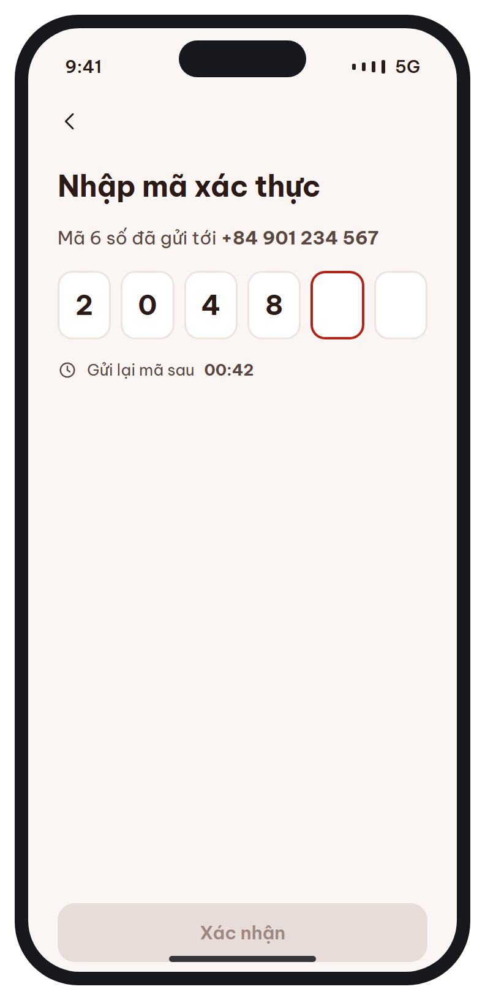 |

### Tìm & chọn phòng

_Từ trang chủ tới chọn gói giá._

| Màn | Tên | Route | Ảnh |
| --- | --- | --- | :---: |
| [MB-03](specs/MB-03.md) | Trang chủ & tìm kiếm | `/home  (tab 1)` |  |
| [MB-03b](specs/MB-03b.md) | Chọn ngày (bottom sheet) | `sheet trên /home` | 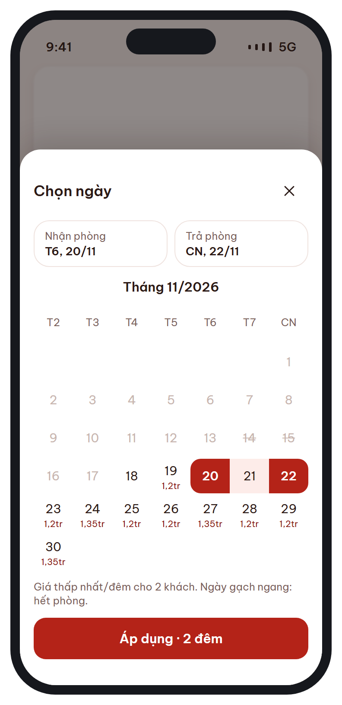 |
| [MB-04](specs/MB-04.md) | Kết quả tìm kiếm | `/search?city&in&out&adults&children&rooms` | 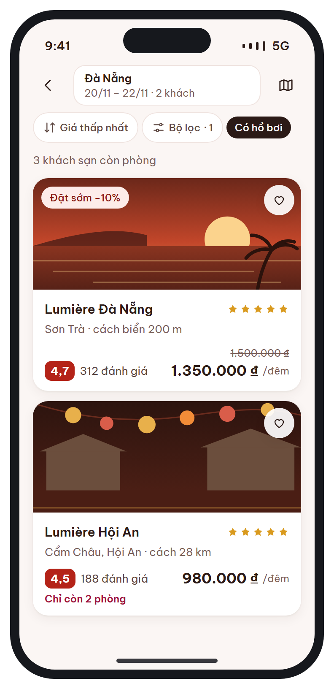 |
| [MB-04e](specs/MB-04e.md) | Không còn phòng (trạng thái rỗng) | `/search (items rỗng)` | 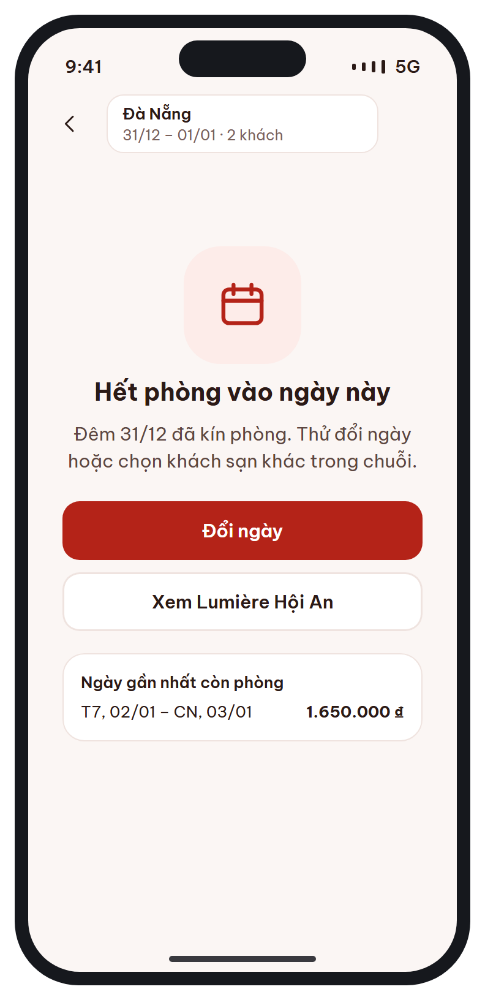 |
| [MB-05](specs/MB-05.md) | Chi tiết khách sạn | `/hotels/:id?in&out&adults&rooms` |  |
| [MB-06](specs/MB-06.md) | Loại phòng & gói giá | `/hotels/:id/rooms/:roomTypeId` | 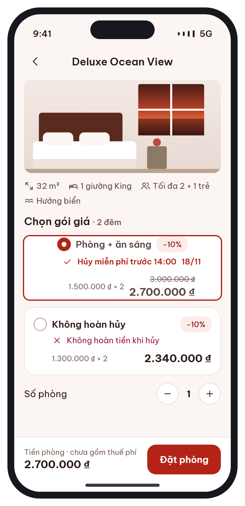 |

### Đặt & thanh toán

_Nhập thông tin, thanh toán, hoàn tất._

| Màn | Tên | Route | Ảnh |
| --- | --- | --- | :---: |
| [MB-07](specs/MB-07.md) | Thông tin khách & dịch vụ thêm | `/booking/guest` |  |
| [MB-08](specs/MB-08.md) | Xác nhận & thanh toán | `/booking/:code/payment` |  |
| [MB-08e](specs/MB-08e.md) | Thanh toán thất bại | `/booking/:code/payment/failed` |  |
| [MB-09](specs/MB-09.md) | Đặt phòng thành công | `/booking/:code/success` | 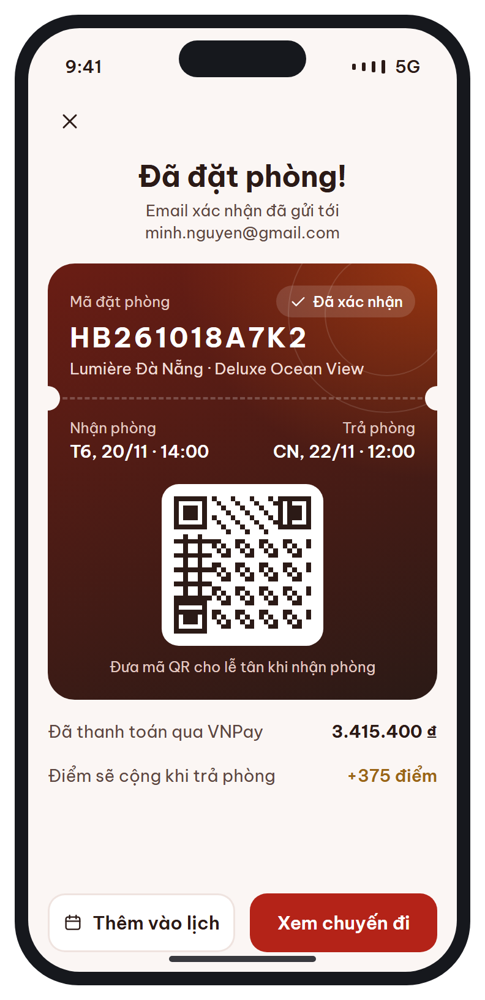 |

### Sau khi đặt

_Quản lý chuyến đi, hủy, đánh giá._

| Màn | Tên | Route | Ảnh |
| --- | --- | --- | :---: |
| [MB-10](specs/MB-10.md) | Chuyến đi của tôi | `/trips  (tab 2)` |  |
| [MB-11](specs/MB-11.md) | Chi tiết đặt phòng | `/trips/:code` | 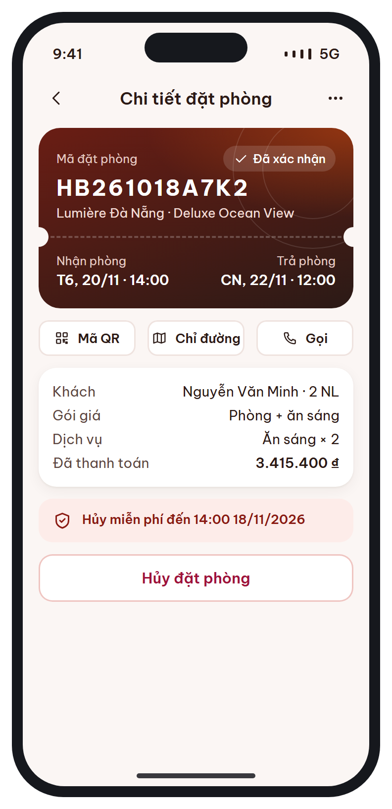 |
| [MB-11c](specs/MB-11c.md) | Xác nhận hủy (bottom sheet) | `sheet trên /trips/:code` | 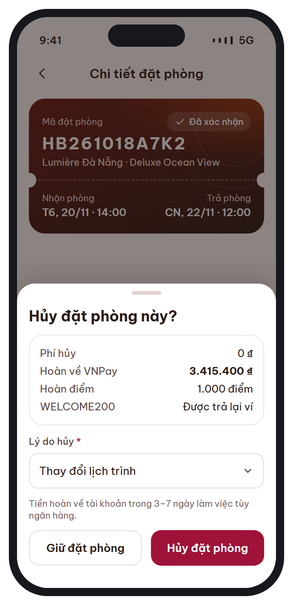 |
| [MB-12](specs/MB-12.md) | Viết đánh giá | `/trips/:code/review` | 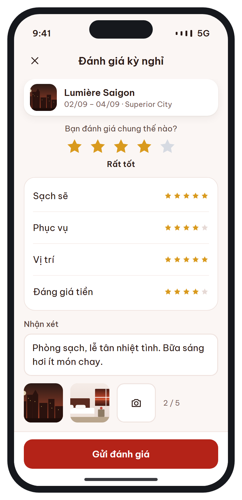 |

### Thành viên & cài đặt

_Điểm, voucher, thông báo, ngôn ngữ._

| Màn | Tên | Route | Ảnh |
| --- | --- | --- | :---: |
| [MB-13](specs/MB-13.md) | Thành viên & điểm | `/account/membership` | 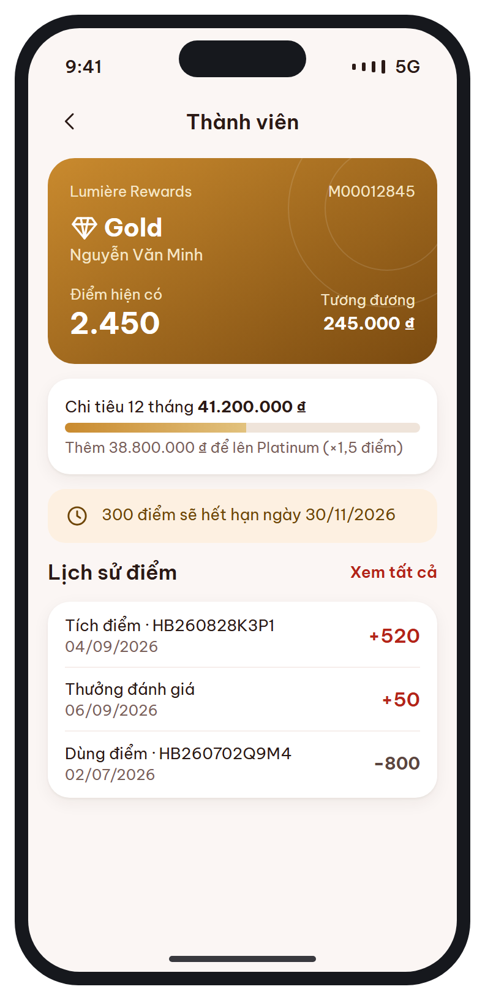 |
| [MB-14](specs/MB-14.md) | Ví voucher | `/offers  (tab 3) · /offers?select=1&booking=:code` |  |
| [MB-15](specs/MB-15.md) | Thông báo | `/notifications` | 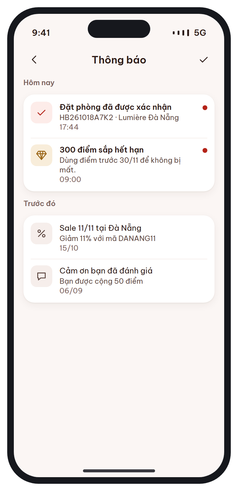 |
| [MB-16](specs/MB-16.md) | Tài khoản | `/account  (tab 4)` |  |
| [MB-16b](specs/MB-16b.md) | Cài đặt ngôn ngữ | `/account/language` |  |

## Sơ đồ điều hướng

```
Khởi động ─ MB-01 (lần đầu) ─▶ Tab shell
Tab shell (go_router StatefulShellRoute, 4 tab)
├─ Trang chủ  MB-03 ─▶ MB-03b(sheet) ─▶ MB-04 / MB-04e ─▶ MB-05 ─▶ MB-06
│                                                   └─(guest)─▶ MB-02 ─▶ MB-02b
│   MB-06 ─▶ MB-07 ─▶ MB-08 ─┬─▶ MB-09 ─▶ MB-10
│                            └─▶ MB-08e ─▶ MB-08
├─ Chuyến đi  MB-10 ─▶ MB-11 ─▶ MB-11c(sheet)
│                   └─▶ MB-12
├─ Ưu đãi     MB-14
└─ Tài khoản  MB-16 ─▶ MB-16b · MB-13
Chuông (MB-03) ─▶ MB-15 ─▶ deep link theo loại thông báo
```

## Nền tảng chung

### Kích thước

| Thành phần | Thông số |
| --- | --- |
| Khung thiết kế | 350 × 770 pt. Layout co giãn theo chiều ngang, lề 16 (form đăng nhập 24) |
| Header (AppBar) | Cao ≥ 52; icon button 44×44; tiêu đề 17/600 căn giữa — màn gốc của tab: 24/700 căn trái |
| Tab bar | 4 tab, ô 44 + safe area; nhãn 11,5 (ngoại lệ duy nhất < 12); tab chọn màu `brand` + 600 |
| Bottom action bar | Nền trắng, viền trên `line`, padding 12 16 + safe area; trái tổng tiền, phải nút chính |
| Button | 48 (bo 14) · sm 36 (bo 10) · xs 30 (bo 8). Biến thể: primary, secondary (viền), ghost (`brandWash`), danger (viền `rose`), dark |
| Input | Cao 48, bo 12, viền 1,5 `line`; focus 2 `brand`; lỗi 1,5 `rose` + help text dưới ô; nhãn luôn hiện phía trên |
| Checkbox / Radio / Switch | 22 / 22 / 44×26 — vùng chạm ≥ 44 |
| Card | Nền trắng, bo 18, padding 14, shadow nhẹ; card đang chọn: viền 2 `brand` |
| Bottom sheet | Bo trên 24, grab 40×5, scrim `rgba(30,18,15,.5)` |
| Ảnh | Tỉ lệ cố định 16:9 (danh sách) / 4:3 (thẻ phòng), bo 12 |

### Màu, chữ, khoảng cách

Xem `tokens/design-tokens.json` và `flutter/lib/theme/`. Tóm tắt: một tông ấm — **đỏ son `#B42318`** cho mọi hành động chính, **nâu gụ `#2B1A16`** cho chữ, **vàng đồng `#9A6516`** chỉ cho hạng thành viên & điểm, cảnh báo `amber`, lỗi `rose` (luôn kèm icon). Không dùng xanh dương, xanh lá, tím, đen tuyền.
Chữ: **Be Vietnam Pro** (vi), **Noto Sans JP** (ja); thang 24 / 20 / 17 / 15 / 13 / 12; số tiền dùng tabular figures. Lưới 4px.

### Component → Flutter widget

| Thiết kế | Widget đề xuất |
| --- | --- |
| Nút (`btn`) | `AppButton(variant, size, icon, loading)` |
| Ô nhập + nhãn | `AppTextField(label, required, errorText, helpText)` |
| Segmented | `AppSegmented` |
| Chip trạng thái | `StatusChip(tone)` |
| Card / dòng danh sách | `AppCard` / `AppListRow(icon, title, value, onTap)` |
| Bottom sheet | `showAppSheet()` |
| Thông báo trong trang | `InlineNotice(tone: amber \| rose \| brand \| sky)` |
| Thẻ chìa khóa (mã + QR) | `BookingKeyCard` (CustomPainter vạch xé + 2 nửa tròn) |
| Dòng giá | `PriceRow(label, amount, emphasize)` |
| Stepper số lượng | `QuantityStepper(min, max)` |
| Trạng thái rỗng | `EmptyState(icon, title, message, actions)` |
| Thanh bước | `StepBar(total: 3, current)` |

### Trạng thái booking → chip

| status | Nhãn VI | Tone |
| --- | --- | --- |
| `PENDING_PAYMENT` | Chờ thanh toán | amber |
| `CONFIRMED` | Đã xác nhận | brand |
| `CHECKED_IN` | Đang ở | sky |
| `CHECKED_OUT` | Đã trả phòng | mặc định |
| `CANCELLED` / `EXPIRED` / `NO_SHOW` | Đã hủy / Hết hạn / Không đến | rose |

### Quy tắc chung

- **i18n:** mọi chuỗi qua ARB (`app_vi.arb`, `app_ja.arb`); không ghép chuỗi, dùng tham số `{count}`, `{date}`; chừa 30% độ dài cho chuỗi dài hơn.
- **Tiền:** số đầy đủ + ₫ — VI `3.415.400 ₫`, JA `3,415,400₫`. Rút gọn chỉ trong ô lịch MB-03b.
- **Ngày:** VI `T6, 20/11`, JA `11/20(金)` — dùng `intl` DateFormat theo locale.
- **Dữ liệu master** có cột `_ja`; thiếu bản dịch thì hiện bản VI.
- **Lỗi API** `{ code, message, details }`: lỗi field → dưới ô; lỗi nghiệp vụ → InlineNotice / dialog; 401 → refresh token, thất bại → MB-02.
- **Tải dữ liệu:** skeleton thay spinner toàn màn; danh sách có pull-to-refresh, phân trang size 20.
- **Mất mạng:** banner "Không có kết nối", giữ dữ liệu cache.
- **Khả dụng:** vùng chạm ≥ 44, `Semantics` cho icon button, hỗ trợ text scale tới 130%.
- **Hiệu năng:** mở trang chủ < 2s trên 4G.

### Cấu trúc project Flutter gợi ý

```
lib/
  app/        router.dart, theme/ (copy từ flutter/lib/theme), l10n/
  core/       api (Dio + interceptors), storage, format (money, date)
  widgets/    AppButton, AppTextField, BookingKeyCard, ...
  features/
    auth/     MB-02, MB-02b
    home/     MB-01, MB-03, MB-03b
    search/   MB-04, MB-04e
    hotel/    MB-05, MB-06
    booking/  MB-07, MB-08, MB-08e, MB-09
    trips/    MB-10, MB-11, MB-11c, MB-12
    member/   MB-13, MB-14
    account/  MB-15, MB-16, MB-16b
```

Package: `flutter_riverpod`, `go_router`, `dio`, `flutter_secure_storage`, `intl`, `flutter_svg`, `cached_network_image`, `google_sign_in`, `sign_in_with_apple`, `firebase_messaging`, `webview_flutter`, `url_launcher`, `app_links`, `qr_flutter`, `image_picker`, `table_calendar`, `google_maps_flutter`.

## API cần bổ sung so với Basic Design §9 (đề xuất)

| Endpoint | Màn | Lý do |
| --- | --- | --- |
| `POST /api/v1/auth/password/reset` | MB-02b | Quên mật khẩu: xác nhận OTP + mật khẩu mới |
| `POST /api/v1/auth/logout` | MB-16 | Thu hồi refresh token & device token |
| `DELETE /api/v1/me` | MB-16 | Xóa tài khoản (NĐ 13/2023) |
| `GET /api/v1/availability/calendar` | MB-03b | Giá thấp nhất & ngày hết phòng trên lịch |
| `suggestions` trong `/hotels/search` | MB-04e | Gợi ý ngày gần nhất / khách sạn khác |
| `POST /api/v1/me/vouchers` | MB-14 | Lưu voucher bằng mã |
| `PATCH …/notifications/{id}/read`, `/read-all`, `DELETE` | MB-15 | Đánh dấu đã đọc, vuốt xóa |

## Vấn đề cần xác nhận

- Voucher / điểm chọn ở MB-08 sau khi booking đã giữ phòng (MB-07), trong khi BR-04 ghi "điểm & voucher bị trừ ngay khi tạo booking". Đề xuất: áp dụng khi gọi `/payments`.
- Basic Design ghi app hỗ trợ vi / ja / **en**; thiết kế hiện có VI, JA.
- Tab Review của mockup gợi ý NativeWind / lucide-react-native (React Native), nhưng Basic Design chọn **Flutter** — bộ thiết kế này theo Flutter.
- Splash + 3 trang giới thiệu (Basic Design §4.1) chưa có thiết kế; MB-01 đang gộp vào màn chọn ngôn ngữ.
