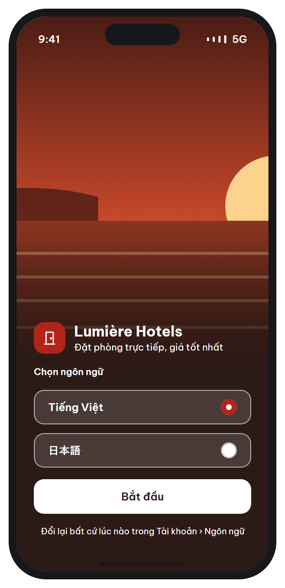
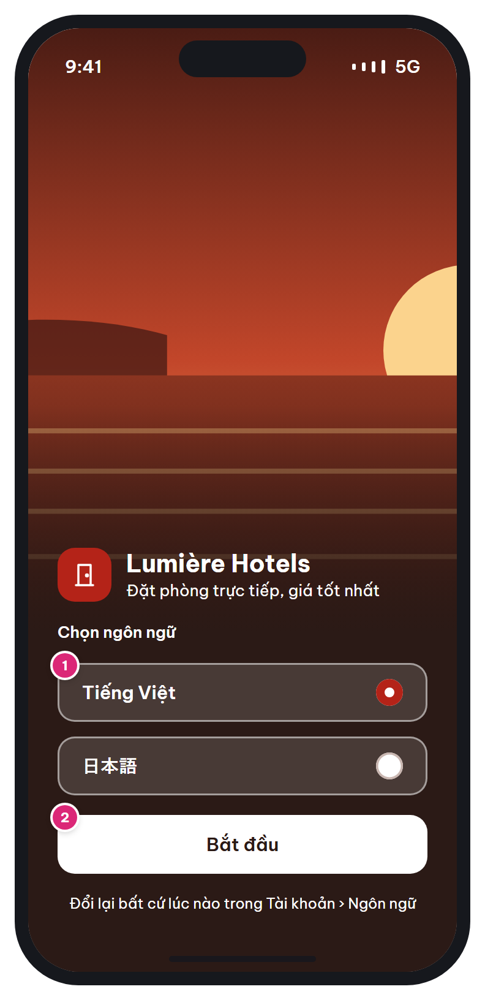

# MB-01 · Chào mừng & chọn ngôn ngữ

[‹ —](../README.md) · [Danh sách](../README.md) · [MB-02 ›](MB-02.md)

**Luồng:** Bắt đầu & tài khoản · **Route:** `/welcome` · **Quyền:** Guest

Màn đầu tiên khi cài app: giới thiệu thương hiệu và chọn ngôn ngữ hiển thị. Chỉ hiện một lần (cờ local `onboarded`).

> Ghi chú thiết kế: Chỉ hiện lần mở app đầu tiên. Mặc định theo ngôn ngữ máy.

| Thiết kế | Có số chú thích |
| :---: | :---: |
|  |  |

## 1. Bố cục

- Nền nâu gụ `--ink`, ảnh minh họa phủ 64% chiều cao phía trên + gradient chuyển về nền.
- Status bar chữ trắng (SystemUiOverlayStyle.light).
- Khối nội dung căn đáy, padding 0 24 48: logo 44×44 + tên + tagline → nhãn 'Chọn ngôn ngữ' → 2 nút chọn ngôn ngữ → nút 'Bắt đầu' → ghi chú.

## 2. Hạng mục màn hình (画面項目定義)

Cột **No** trùng với số hồng trên ảnh có chú thích.

| No | Hạng mục | Loại UI | Dữ liệu / nguồn | Ràng buộc / validate | Hành động |
| --- | --- | --- | --- | --- | --- |
| – | Logo + tên thương hiệu | Image + Text t-l | Asset tĩnh |  |  |
| 1 | Lựa chọn ngôn ngữ (VI / JA) | Radio row (nút cao 48, viền trắng 50%) | Mặc định theo `Platform.localeName`: `ja*` → ja, còn lại → vi | Bắt buộc 1 lựa chọn | Chạm → đổi ngôn ngữ toàn app ngay lập tức (không cần khởi động lại) |
| 2 | Nút Bắt đầu | Primary button trắng, full width |  |  | Lưu `app.lang`, `onboarded=true` vào SharedPreferences → [MB-03](MB-03.md) |
| – | Ghi chú đổi ngôn ngữ | Text t-xs, căn giữa | i18n |  |  |

## 3. API

| Method | Endpoint | Ghi chú |
| --- | --- | --- |
| — | `(không gọi API)` | Nếu đăng nhập sau này, đồng bộ `users.language` bằng PATCH /api/v1/me |

## 4. Trạng thái màn hình

| Trạng thái | Hiển thị / xử lý |
| --- | --- |
| Lần mở sau | Bỏ qua [MB-01](MB-01.md), vào thẳng [MB-03](MB-03.md) |

## 5. Quy tắc nghiệp vụ

- Basic Design §12: app hỗ trợ vi / ja / en — mockup mới có VI, JA. Nếu bật EN chỉ cần thêm 1 dòng radio.

## 6. Điều hướng

| Thao tác | Màn đích |
| --- | --- |
| Bắt đầu | [MB-03](MB-03.md) Trang chủ (replace, không back được) |

## 7. i18n key gợi ý

`welcome.tagline` · `welcome.chooseLanguage` · `welcome.start` · `welcome.changeLater`

## 8. Gợi ý triển khai Flutter

- Stack(Image 64% + DecoratedBox gradient) + Align(bottom)
- Riverpod `localeProvider` (StateNotifier<Locale>) → MaterialApp.locale
- flutter_localizations + intl (ARB: app_vi.arb, app_ja.arb)

---

[‹ —](../README.md) · [Danh sách](../README.md) · [MB-02 ›](MB-02.md)
