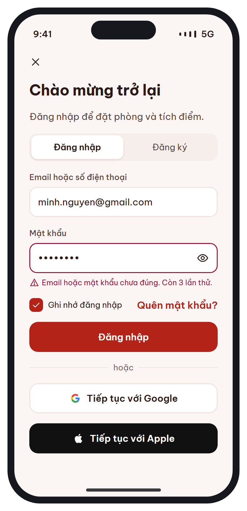
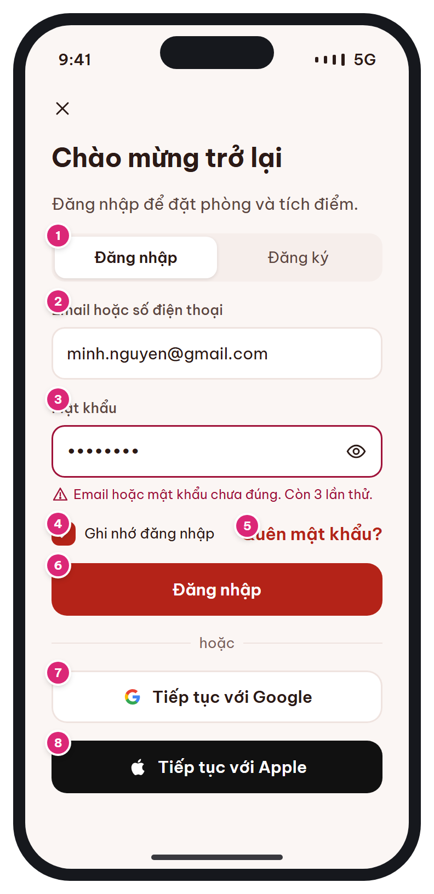

# MB-02 · Đăng nhập / Đăng ký

[‹ MB-01](MB-01.md) · [Danh sách](../README.md) · [MB-02b ›](MB-02b.md)

**Luồng:** Bắt đầu & tài khoản · **Route:** `/auth/login?returnTo=` · **Quyền:** Guest

Đăng nhập bằng email/SĐT + mật khẩu, Google hoặc Apple. Tab Đăng ký dùng cùng khung form và xác thực OTP (MB-02b).

> Ghi chú thiết kế: Tab Đăng ký dùng cùng form + OTP (MB-02b).

| Thiết kế | Có số chú thích |
| :---: | :---: |
|  |  |

## 1. Bố cục

- Header 52px: nút đóng (X) bên trái.
- Nội dung padding ngang 24, gap 16: tiêu đề t-xl → mô tả → segmented control → form → link → nút chính → divider 'hoặc' → nút social.

## 2. Hạng mục màn hình (画面項目定義)

Cột **No** trùng với số hồng trên ảnh có chú thích.

| No | Hạng mục | Loại UI | Dữ liệu / nguồn | Ràng buộc / validate | Hành động |
| --- | --- | --- | --- | --- | --- |
| 1 | Segmented Đăng nhập / Đăng ký | Segmented control (cao 38) |  |  | Đổi tab: Đăng ký hiện thêm Họ tên, Mật khẩu nhập lại, checkbox đồng ý điều khoản & xử lý dữ liệu cá nhân (NĐ 13/2023) |
| 2 | Email hoặc số điện thoại | Text input 48px, nhãn luôn hiện | users.email / users.phone | Bắt buộc. Email RFC hoặc SĐT VN `^(\+84\|0)\d{9}$` → chuẩn hóa E.164 | keyboardType: emailAddress; autofill username |
| 3 | Mật khẩu | Password input + nút hiện/ẩn (icon eye) | users.password_hash (bcrypt) | Bắt buộc, ≥ 8 ký tự (đăng ký: có chữ & số). Lỗi hiển thị dưới ô kèm số lần thử còn lại | autofill password |
| 4 | Ghi nhớ đăng nhập | Checkbox 22px (vùng chạm 44) |  | Mặc định bật | Bật: lưu refresh token vào secure storage; tắt: chỉ giữ trong bộ nhớ |
| 5 | Quên mật khẩu? | Text link |  |  | → [MB-02b](MB-02b.md) (purpose=RESET) → màn đặt mật khẩu mới |
| 6 | Nút Đăng nhập | Primary button 48px |  | Disable khi 1 trong 2 ô rỗng; loading khi gọi API | POST /auth/login → lưu token → quay về `returnTo` hoặc [MB-03](MB-03.md) |
| 7 | Tiếp tục với Google | Secondary button + icon | users.social_provider='GOOGLE', social_id |  | google_sign_in → POST /auth/social |
| 8 | Tiếp tục với Apple | Button đen (theo HIG Apple) | users.social_provider='APPLE' | Bắt buộc có trên iOS khi app có đăng nhập social | sign_in_with_apple → POST /auth/social |

## 3. API

| Method | Endpoint | Ghi chú |
| --- | --- | --- |
| POST | `/api/v1/auth/login` | { login, password, device_token, platform } → { access_token(15'), refresh_token(30 ngày), user } |
| POST | `/api/v1/auth/social` | { provider: GOOGLE\|APPLE, id_token } → giống login |
| POST | `/api/v1/auth/otp` | Tab Đăng ký: { target, purpose: REGISTER } → sang MB-02b |

## 4. Trạng thái màn hình

| Trạng thái | Hiển thị / xử lý |
| --- | --- |
| Sai thông tin | Ô mật khẩu viền `--rose`, help text lỗi: "Email hoặc mật khẩu chưa đúng. Còn {n} lần thử." |
| Bị khóa tạm (rate-limit) | Toast rose: "Thử lại sau {mm:ss}"; disable nút Đăng nhập |
| Mất mạng | SnackBar "Không có kết nối" + giữ nguyên dữ liệu đã nhập |
| Đang gửi | Nút hiển thị spinner, khóa form |

## 5. Quy tắc nghiệp vụ

- Bảo mật §12: JWT access 15 phút + refresh 30 ngày (xoay vòng), rate-limit đăng nhập/OTP.
- Khách chưa đăng nhập xem được tới [MB-06](MB-06.md); bấm 'Đặt phòng' → [MB-02](MB-02.md) rồi quay lại (returnTo).

## 6. Điều hướng

| Thao tác | Màn đích |
| --- | --- |
| X | Đóng (pop) – giữ trạng thái guest |
| Đăng nhập thành công | returnTo (VD [MB-07](MB-07.md)) hoặc [MB-03](MB-03.md) |
| Đăng ký → Tiếp tục | [MB-02b](MB-02b.md) |
| Quên mật khẩu? | [MB-02b](MB-02b.md) |

## 7. i18n key gợi ý

`auth.login.title` · `auth.login.subtitle` · `auth.field.loginId` · `auth.field.password` · `auth.error.invalid {remaining}` · `auth.remember` · `auth.forgot` · `auth.or` · `auth.google` · `auth.apple`

## 8. Gợi ý triển khai Flutter

- Form + TextFormField(autovalidateMode: onUserInteraction)
- AutofillGroup cho username/password
- flutter_secure_storage cho refresh token; Dio interceptor tự refresh khi 401

---

[‹ MB-01](MB-01.md) · [Danh sách](../README.md) · [MB-02b ›](MB-02b.md)
