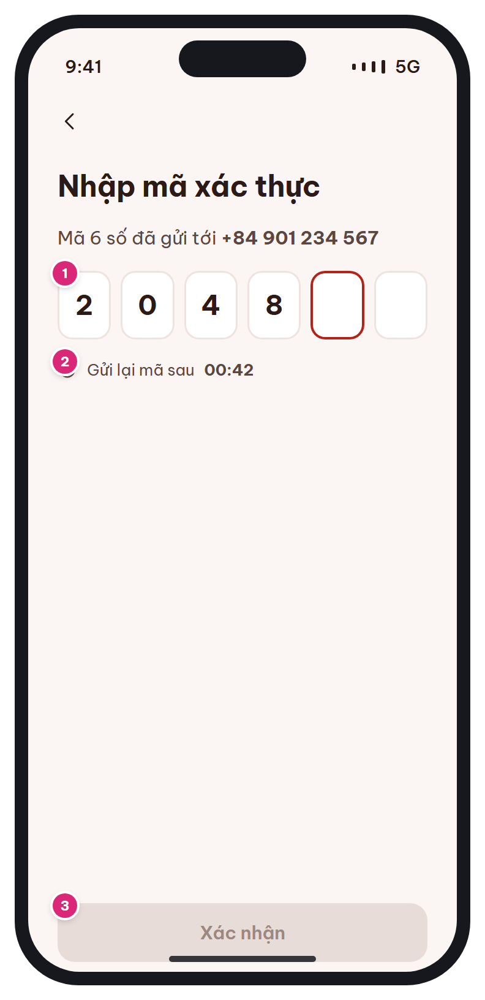

# MB-02b · Xác thực OTP

[‹ MB-02](MB-02.md) · [Danh sách](../README.md) · [MB-03 ›](MB-03.md)

**Luồng:** Bắt đầu & tài khoản · **Route:** `/auth/otp?purpose=REGISTER|RESET` · **Quyền:** Guest

Nhập mã 6 số gửi qua SMS/email khi đăng ký hoặc quên mật khẩu.

> Ghi chú thiết kế: 6 số, hết hạn sau 5 phút, gửi lại sau 60 giây.

| Thiết kế | Có số chú thích |
| :---: | :---: |
|  |  |

## 1. Bố cục

- Header: nút back + tiêu đề.
- Mô tả kèm số/email đích (che bớt).
- 6 ô OTP ngang, đếm ngược gửi lại, nút Xác nhận.

## 2. Hạng mục màn hình (画面項目定義)

Cột **No** trùng với số hồng trên ảnh có chú thích.

| No | Hạng mục | Loại UI | Dữ liệu / nguồn | Ràng buộc / validate | Hành động |
| --- | --- | --- | --- | --- | --- |
| – | Đích nhận mã | Text t-b | Giá trị đã nhập ở [MB-02](MB-02.md) | Che giữa nếu là email (m***@gmail.com) |  |
| 1 | Ô nhập OTP (6 ô) | 6 ô 48×56, focus viền đỏ son | Redis `otp:{purpose}:{target}` TTL 5 phút | Chỉ số; dán được cả 6 số; tự submit khi đủ 6 | iOS: textContentType oneTimeCode; Android: SMS Retriever |
| 2 | Đếm ngược gửi lại | Icon clock + text mm:ss | Client đếm 60s từ lần gửi | Tối đa 5 lần gửi / giờ / đích | Hết giờ → link "Gửi lại mã" → POST /auth/otp |
| 3 | Nút Xác nhận | Primary 48px |  | Disable khi < 6 số | REGISTER: POST /auth/register; RESET: chuyển màn đặt mật khẩu mới |

## 3. API

| Method | Endpoint | Ghi chú |
| --- | --- | --- |
| POST | `/api/v1/auth/otp` | { target, purpose } – gửi / gửi lại |
| POST | `/api/v1/auth/register` | { full_name, email\|phone, password, otp, consent:true } → token + user |
| POST | `/api/v1/auth/password/reset` | ĐỀ XUẤT BỔ SUNG (chưa có trong API list): { target, otp, new_password } |

## 4. Trạng thái màn hình

| Trạng thái | Hiển thị / xử lý |
| --- | --- |
| Sai mã | Rung ô + text lỗi "Mã không đúng. Còn {n} lần thử" (tối đa 5) |
| Hết hạn (5 phút) | Text lỗi + tự hiện link Gửi lại |
| Đang xác nhận | Spinner trên nút |

## 5. Quy tắc nghiệp vụ

- OTP 6 số, hết hạn 5 phút, gửi lại sau 60 giây (mockup [MB-02b](MB-02b.md)).
- Đăng ký phải có đồng ý xử lý dữ liệu cá nhân (NĐ 13/2023).

## 6. Điều hướng

| Thao tác | Màn đích |
| --- | --- |
| Back | [MB-02](MB-02.md) (giữ dữ liệu form) |
| Xác nhận (REGISTER) | returnTo hoặc [MB-03](MB-03.md) |
| Xác nhận (RESET) | Màn đặt mật khẩu mới → [MB-02](MB-02.md) |

## 7. i18n key gợi ý

`otp.title` · `otp.sentTo {target}` · `otp.resendIn {time}` · `otp.resend` · `otp.confirm` · `otp.error.invalid {remaining}` · `otp.error.expired`

## 8. Gợi ý triển khai Flutter

- Package pinput (hoặc 6 TextField + FocusNode)
- Timer.periodic cho đếm ngược; dừng khi dispose

---

[‹ MB-02](MB-02.md) · [Danh sách](../README.md) · [MB-03 ›](MB-03.md)
