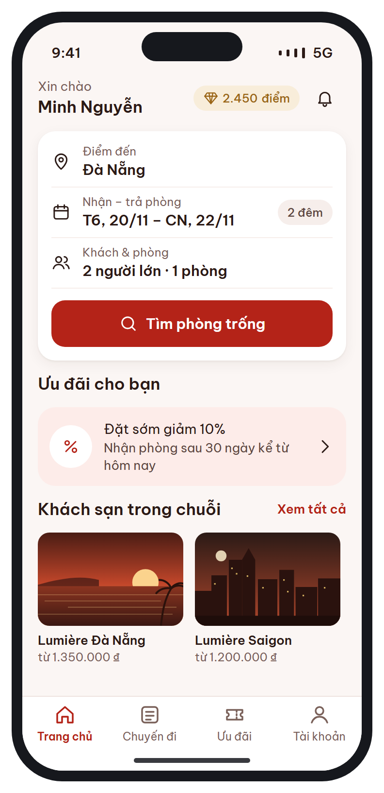
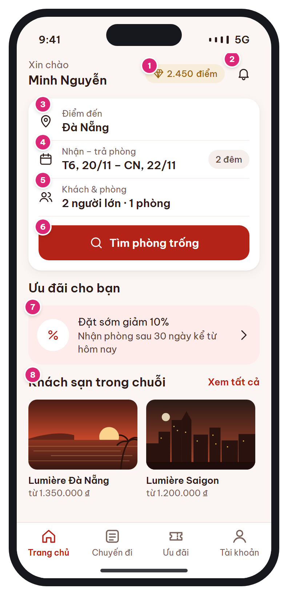

# MB-03 · Trang chủ & tìm kiếm

[‹ MB-02b](MB-02b.md) · [Danh sách](../README.md) · [MB-03b ›](MB-03b.md)

**Luồng:** Tìm & chọn phòng · **Route:** `/home  (tab 1)` · **Quyền:** Guest / Member

Điểm bắt đầu tìm phòng: form tìm kiếm, ưu đãi nổi bật, danh sách khách sạn trong chuỗi.

> Ghi chú thiết kế: Bấm ô ngày mở MB-03b, ô khách mở sheet chọn khách.

| Thiết kế | Có số chú thích |
| :---: | :---: |
|  |  |

## 1. Bố cục

- Header: lời chào + tên (trái), chip điểm + chuông (phải).
- Card tìm kiếm: 3 list-row (Điểm đến / Ngày / Khách & phòng) + nút Tìm phòng.
- Section 'Ưu đãi cho bạn': card khuyến mãi.
- Section 'Khách sạn trong chuỗi': carousel ngang thẻ ảnh 4:3.
- Tab bar 4 mục (Trang chủ đang chọn).

## 2. Hạng mục màn hình (画面項目定義)

Cột **No** trùng với số hồng trên ảnh có chú thích.

| No | Hạng mục | Loại UI | Dữ liệu / nguồn | Ràng buộc / validate | Hành động |
| --- | --- | --- | --- | --- | --- |
| – | Lời chào | Text t-xl | users.full_name (tên gọi = từ cuối) | Guest: "Xin chào" + nút Đăng nhập |  |
| 1 | Chip điểm | Chip gold + icon gem | users.point_balance | Ẩn khi guest | → [MB-13](MB-13.md) |
| 2 | Chuông thông báo | Icon button 44 + chấm đỏ | Số chưa đọc (notifications.is_read=false) | Chấm hiện khi > 0 | → [MB-15](MB-15.md) |
| 3 | Điểm đến | List-row (icon pin) | hotels.city / hotel cụ thể | Bắt buộc | Mở sheet chọn điểm đến (tìm theo thành phố / tên khách sạn) |
| 4 | Nhận – trả phòng | List-row (icon calendar) | check_in, check_out, số đêm | Mặc định hôm nay+1 → +3; ≤ 30 đêm; check-in ≤ 365 ngày tới | → [MB-03b](MB-03b.md) |
| 5 | Khách & phòng | List-row (icon users) | adults, children (+tuổi), rooms | rooms 1–5; người lớn ≥ 1/phòng | Mở sheet chọn khách (stepper) |
| 6 | Tìm phòng trống | Primary button full |  | Đủ 3 trường | → [MB-04](MB-04.md) với tham số tìm kiếm; lưu lần tìm cuối vào local |
| 7 | Card ưu đãi | Card + icon percent + chevron | banners / promotions từ GET /home | Chỉ banner ACTIVE trong [start_at, end_at] | Deep link theo banners.link_type / link_value |
| 8 | Khách sạn trong chuỗi | Carousel ngang, thẻ ảnh + tên + "từ {giá}" | hotels + giá thấp nhất |  | → [MB-05](MB-05.md) |
| – | Tab bar | 4 tab: Trang chủ · Chuyến đi · Ưu đãi · Tài khoản |  | Cao 44 + safe area | [MB-03](MB-03.md) / [MB-10](MB-10.md) / [MB-14](MB-14.md) / [MB-16](MB-16.md) |

## 3. API

| Method | Endpoint | Ghi chú |
| --- | --- | --- |
| GET | `/api/v1/home` | { banners[], promotions[], hotels[{id,name,name_ja,city,cover_url,min_price}] } |
| GET | `/api/v1/me` | Lấy tên, điểm (nếu đã đăng nhập) |
| GET | `/api/v1/me/notifications?unread=1&size=1` | Lấy unread_count cho chấm đỏ |

## 4. Trạng thái màn hình

| Trạng thái | Hiển thị / xử lý |
| --- | --- |
| Đang tải | Skeleton cho card ưu đãi + carousel; form tìm kiếm hiển thị ngay |
| Lỗi tải /home | Ẩn 2 section dưới, form vẫn dùng được; kéo xuống để thử lại |
| Guest | Ẩn chip điểm; chuông → [MB-02](MB-02.md) |

## 5. Quy tắc nghiệp vụ

- BR-01: tối đa 30 đêm, 5 phòng / booking, check-in không quá 365 ngày tới.

## 6. Điều hướng

| Thao tác | Màn đích |
| --- | --- |
| Ô ngày | [MB-03b](MB-03b.md) (bottom sheet) |
| Tìm phòng | [MB-04](MB-04.md) |
| Chip điểm | [MB-13](MB-13.md) |
| Chuông | [MB-15](MB-15.md) |
| Thẻ khách sạn | [MB-05](MB-05.md) |

## 7. i18n key gợi ý

`home.greeting {name}` · `home.points {n}` · `search.destination` · `search.dates` · `search.nights {count}` · `search.guests {adults} {rooms}` · `search.submit` · `home.offers` · `home.chainHotels` · `home.seeAll` · `price.from {amount}`

## 8. Gợi ý triển khai Flutter

- CustomScrollView + SliverList
- searchQueryProvider (StateNotifier) dùng chung MB-03 / MB-03b / MB-04
- BottomNavigationBar → dùng StatefulShellRoute (go_router) giữ state từng tab

---

[‹ MB-02b](MB-02b.md) · [Danh sách](../README.md) · [MB-03b ›](MB-03b.md)
