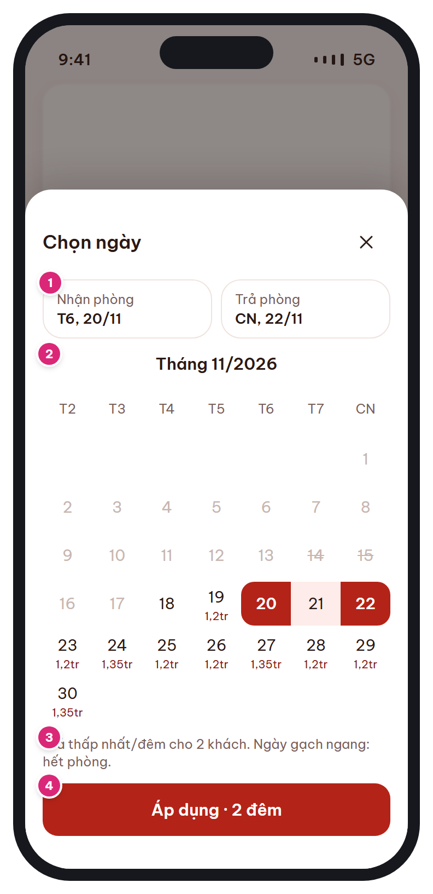

# MB-03b · Chọn ngày (bottom sheet)

[‹ MB-03](MB-03.md) · [Danh sách](../README.md) · [MB-04 ›](MB-04.md)

**Luồng:** Tìm & chọn phòng · **Route:** `sheet trên /home` · **Quyền:** Guest / Member

Chọn khoảng ngày nhận – trả phòng, có giá thấp nhất/đêm dưới mỗi ngày và đánh dấu ngày hết phòng.

> Ghi chú thiết kế: Hiện giá thấp nhất/đêm dưới mỗi ngày; ngày hết phòng bị gạch.

| Thiết kế | Có số chú thích |
| :---: | :---: |
|  |  |

## 1. Bố cục

- Scrim 50% phủ [MB-03](MB-03.md).
- Sheet bo góc 24, grab handle, tiêu đề + nút đóng.
- 2 card Nhận phòng / Trả phòng.
- Lịch tháng (cuộn dọc nhiều tháng), chú giải, nút Áp dụng.

## 2. Hạng mục màn hình (画面項目定義)

Cột **No** trùng với số hồng trên ảnh có chú thích.

| No | Hạng mục | Loại UI | Dữ liệu / nguồn | Ràng buộc / validate | Hành động |
| --- | --- | --- | --- | --- | --- |
| 1 | Card Nhận phòng / Trả phòng | 2 card ngang, card đang chọn viền brand | check_in / check_out |  | Chạm card để chọn lại mốc tương ứng |
| 2 | Lịch tháng | Grid 7 cột, ô 40px; ngày đầu/cuối nền brand, ngày giữa nền brand-wash | room_inventories (giá thấp nhất/đêm, còn phòng) | Ngày quá khứ disable; ngày hết phòng gạch ngang, không chọn làm ngày nhận (vẫn chọn làm ngày trả được); ≤ 30 đêm | Chạm lần 1 = nhận, lần 2 = trả; chạm ngày trước ngày nhận → đặt lại ngày nhận |
| – | Giá dưới ngày | Text 10px màu brand-ink | min price theo số khách | Định dạng rút gọn (1,2tr / 1.2M) — ngoại lệ duy nhất cho app vì chỗ hẹp |  |
| 3 | Chú giải | Text t-xs sub | i18n |  |  |
| 4 | Nút Áp dụng · N đêm | Primary full |  | Disable khi chưa đủ 2 ngày | Cập nhật searchQuery → đóng sheet |

## 3. API

| Method | Endpoint | Ghi chú |
| --- | --- | --- |
| GET | `/api/v1/availability/calendar?city\|hotel_id&from&to&adults&rooms` | ĐỀ XUẤT BỔ SUNG: [{date, min_price, available:boolean}] – cache 5 phút, tải theo từng tháng khi cuộn |

## 4. Trạng thái màn hình

| Trạng thái | Hiển thị / xử lý |
| --- | --- |
| Đang tải giá | Lịch hiện ngay, giá hiện dạng shimmer nhỏ |
| Lỗi giá | Ẩn giá, vẫn cho chọn ngày |

## 5. Quy tắc nghiệp vụ

- BR-01: phòng trống khi MỌI đêm stop_sell=false và total − booked − blocked ≥ số phòng.
- Giá hiển thị = giá thấp nhất/đêm đã gồm KM tự động, chưa thuế phí.

## 6. Điều hướng

| Thao tác | Màn đích |
| --- | --- |
| Áp dụng / X / vuốt xuống | Đóng sheet về [MB-03](MB-03.md) |

## 7. i18n key gợi ý

`dates.title` · `dates.checkIn` · `dates.checkOut` · `dates.legend` · `dates.apply {nights}`

## 8. Gợi ý triển khai Flutter

- showModalBottomSheet(isScrollControlled, useSafeArea)
- table_calendar (rangeSelectionMode) hoặc tự dựng GridView
- Thứ bắt đầu: T2 cho vi; 日 cho ja (theo MaterialLocalizations.firstDayOfWeekIndex)

---

[‹ MB-03](MB-03.md) · [Danh sách](../README.md) · [MB-04 ›](MB-04.md)
