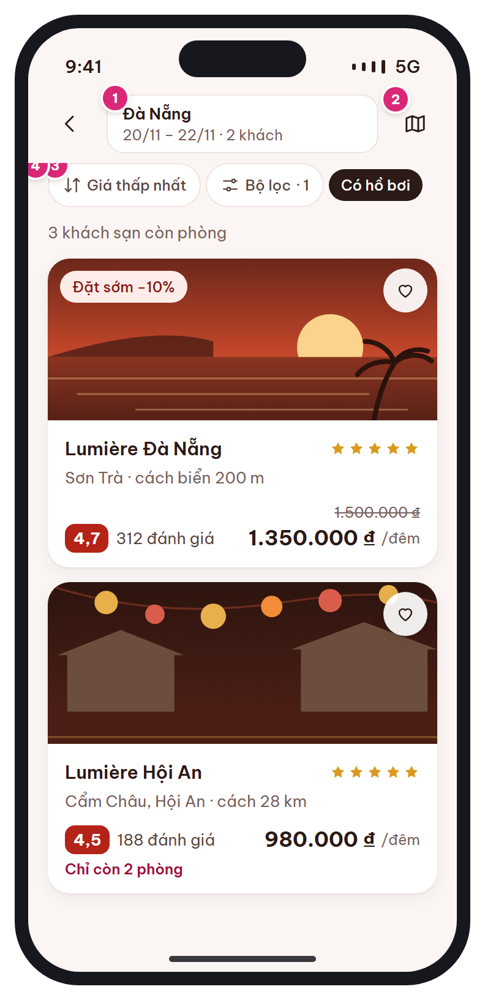

# MB-04 · Kết quả tìm kiếm

[‹ MB-03b](MB-03b.md) · [Danh sách](../README.md) · [MB-04e ›](MB-04e.md)

**Luồng:** Tìm & chọn phòng · **Route:** `/search?city&in&out&adults&children&rooms` · **Quyền:** Guest / Member

Danh sách khách sạn còn phòng theo điều kiện, có sắp xếp, lọc và bản đồ.

> Ghi chú thiết kế: Giá hiển thị = giá thấp nhất/đêm đã gồm KM tự động, chưa thuế phí.

| Thiết kế | Có số chú thích |
| :---: | :---: |
|  |  |

## 1. Bố cục

- Header: back + tóm tắt tìm kiếm (2 dòng) + nút bản đồ.
- Hàng chip: Sắp xếp, Bộ lọc · n, chip lọc đang bật.
- Text số kết quả.
- Danh sách thẻ khách sạn (ảnh 16:9).

## 2. Hạng mục màn hình (画面項目定義)

Cột **No** trùng với số hồng trên ảnh có chú thích.

| No | Hạng mục | Loại UI | Dữ liệu / nguồn | Ràng buộc / validate | Hành động |
| --- | --- | --- | --- | --- | --- |
| 1 | Tóm tắt tìm kiếm | Header 2 dòng (điểm đến / ngày · khách) | searchQuery |  | Chạm → mở sheet sửa điều kiện |
| 2 | Nút bản đồ | Icon button | hotels.latitude/longitude |  | Chuyển chế độ bản đồ (pin = giá/đêm) |
| 3 | Sắp xếp / Bộ lọc | Chip out 36px | sort: PRICE_ASC \| RATING \| DISTANCE; filter: giá, hạng sao, tiện nghi, hủy miễn phí |  | Mở bottom sheet; số trên chip = số bộ lọc đang bật |
| – | Chip lọc đang bật | Chip on (nền ink) |  |  | Chạm để bỏ lọc |
| 4 | Thẻ khách sạn | Card: ảnh + badge KM + tim, tên, sao, khu vực, điểm đánh giá, giá | Kết quả search |  | → [MB-05](MB-05.md) |
| – | Nút tim (yêu thích) | Icon button raised trên ảnh | favorites | Guest → [MB-02](MB-02.md) | PUT /me/favorites/{hotelId} (toggle, optimistic) |
| – | Giá | Gạch giá gốc + giá sau KM + "/đêm" | min_price_before_promo, min_price | Giá thấp nhất/đêm đã gồm KM tự động, chưa thuế phí |  |
| – | Khan hiếm | Text rose "Chỉ còn {n} phòng" | rooms_left | Hiện khi ≤ 3 |  |

## 3. API

| Method | Endpoint | Ghi chú |
| --- | --- | --- |
| GET | `/api/v1/hotels/search` | Query: city, check_in, check_out, adults, children, rooms, sort, filters, page, size=20 → { items[{hotel_id, name, name_ja, star_rating, area_text, distance_m, rating_avg, review_count, cover_url, min_price, min_price_before_promo, promotion_label, rooms_left, is_favorite}], total, suggestions? } |
| PUT | `/api/v1/me/favorites/{hotelId}` | Thêm / bỏ yêu thích |

## 4. Trạng thái màn hình

| Trạng thái | Hiển thị / xử lý |
| --- | --- |
| Đang tải | 3 skeleton card |
| 0 kết quả | → hiển thị [MB-04e](MB-04e.md) (cùng route) |
| Lỗi mạng | Empty state + nút Thử lại |
| Cuộn hết trang | Infinite scroll tải trang kế (p95 < 1,5s) |

## 5. Quy tắc nghiệp vụ

- BR-01 tình trạng trống; BR-02 giá đêm; BR-03② KM tự động 1 cái priority cao nhất.
- NFR: tìm kiếm p95 < 1,5s.

## 6. Điều hướng

| Thao tác | Màn đích |
| --- | --- |
| Back | [MB-03](MB-03.md) |
| Thẻ khách sạn | [MB-05](MB-05.md) |
| Không có kết quả | [MB-04e](MB-04e.md) |

## 7. i18n key gợi ý

`search.resultCount {count}` · `search.sort.priceAsc` · `search.filter {count}` · `price.perNight` · `hotel.reviews {count}` · `hotel.roomsLeft {count}`

## 8. Gợi ý triển khai Flutter

- PagingController (infinite_scroll_pagination)
- google_maps_flutter cho chế độ bản đồ
- CachedNetworkImage, AspectRatio 16/9

---

[‹ MB-03b](MB-03b.md) · [Danh sách](../README.md) · [MB-04e ›](MB-04e.md)
