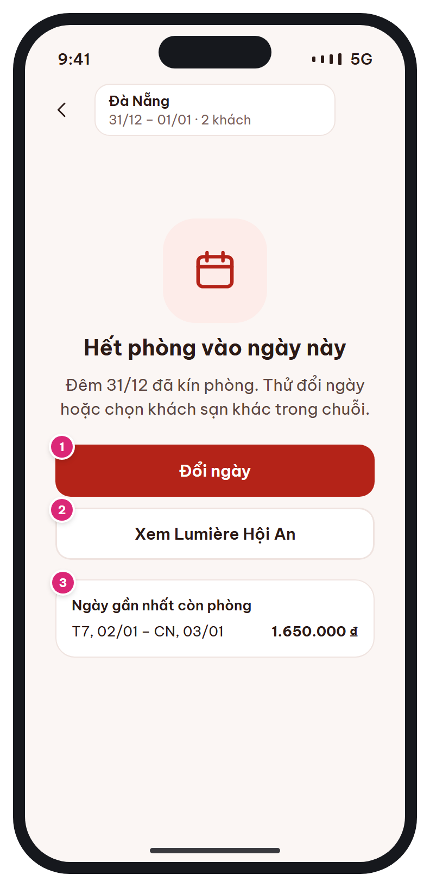

# MB-04e · Không còn phòng (trạng thái rỗng)

[‹ MB-04](MB-04.md) · [Danh sách](../README.md) · [MB-05 ›](MB-05.md)

**Luồng:** Tìm & chọn phòng · **Route:** `/search (items rỗng)` · **Quyền:** Guest / Member

Khi không có khách sạn nào còn phòng: giải thích lý do và gợi ý hành động thay vì ngõ cụt.

> Ghi chú thiết kế: Gợi ý hành động thay vì chỉ báo lỗi.

| Thiết kế | Có số chú thích |
| :---: | :---: |
|  |  |

## 1. Bố cục

- Header giống [MB-04](MB-04.md).
- Empty state: minh họa 96px + tiêu đề + mô tả.
- 2 nút hành động, card 'Ngày gần nhất còn phòng'.

## 2. Hạng mục màn hình (画面項目定義)

Cột **No** trùng với số hồng trên ảnh có chú thích.

| No | Hạng mục | Loại UI | Dữ liệu / nguồn | Ràng buộc / validate | Hành động |
| --- | --- | --- | --- | --- | --- |
| – | Minh họa + thông điệp | Empty state |  | Nêu rõ đêm bị kín (VD "Đêm 31/12 đã kín phòng") |  |
| 1 | Đổi ngày | Primary button |  |  | → [MB-03b](MB-03b.md) |
| 2 | Xem khách sạn khác trong chuỗi | Secondary button | suggestions.alt_hotels[0] | Ẩn nếu không có gợi ý | → [MB-05](MB-05.md) của khách sạn đó (giữ ngày) |
| 3 | Ngày gần nhất còn phòng | Card: khoảng ngày + giá | suggestions.nearest_dates { check_in, check_out, min_price } | Ẩn nếu không tìm thấy trong 30 ngày | Áp dụng ngày → tìm lại ([MB-04](MB-04.md)) |

## 3. API

| Method | Endpoint | Ghi chú |
| --- | --- | --- |
| GET | `/api/v1/hotels/search` | ĐỀ XUẤT: khi total=0 trả thêm suggestions { sold_out_dates[], alt_hotels[], nearest_dates } |

## 4. Trạng thái màn hình

| Trạng thái | Hiển thị / xử lý |
| --- | --- |
| Bộ lọc đang bật | Thêm nút "Xóa bộ lọc" trước các gợi ý |

## 5. Quy tắc nghiệp vụ

- Review v1→v2 #6: không để danh sách rỗng là ngõ cụt.

## 6. Điều hướng

| Thao tác | Màn đích |
| --- | --- |
| Đổi ngày | [MB-03b](MB-03b.md) |
| Khách sạn khác | [MB-05](MB-05.md) |
| Ngày gần nhất | [MB-04](MB-04.md) (tìm lại) |

## 7. i18n key gợi ý

`search.empty.title` · `search.empty.desc {date}` · `search.empty.changeDates` · `search.empty.seeHotel {name}` · `search.empty.nearest`

## 8. Gợi ý triển khai Flutter

- Widget EmptyState dùng chung (icon, title, message, actions)

---

[‹ MB-04](MB-04.md) · [Danh sách](../README.md) · [MB-05 ›](MB-05.md)
