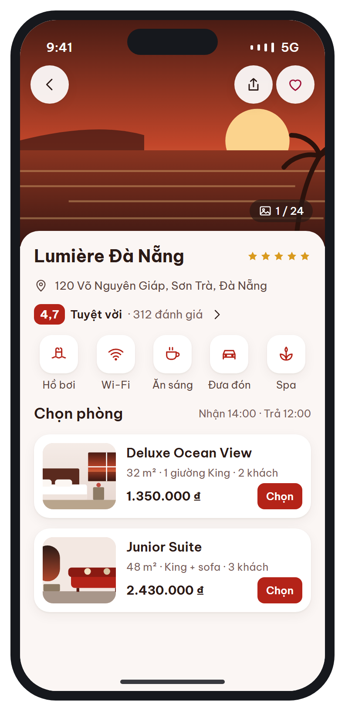
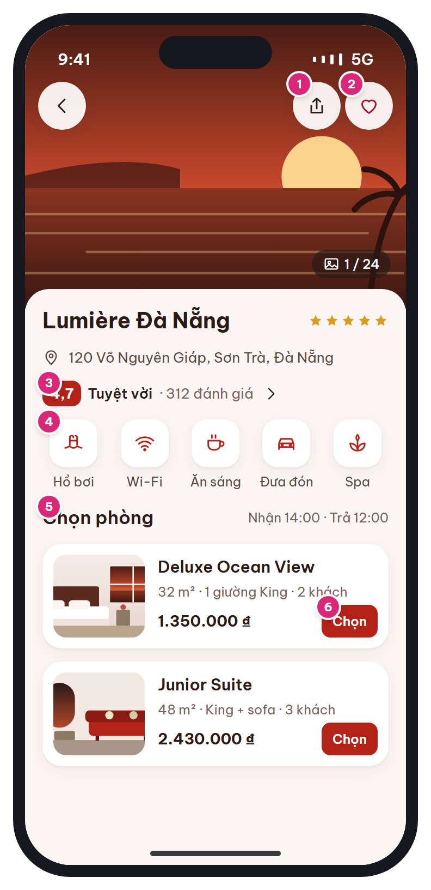

# MB-05 · Chi tiết khách sạn

[‹ MB-04e](MB-04e.md) · [Danh sách](../README.md) · [MB-06 ›](MB-06.md)

**Luồng:** Tìm & chọn phòng · **Route:** `/hotels/:id?in&out&adults&rooms` · **Quyền:** Guest / Member

Thông tin khách sạn (ảnh, vị trí, đánh giá, tiện nghi) và danh sách loại phòng còn trống theo ngày đã chọn.

> Ghi chú thiết kế: Ảnh vuốt ngang; danh sách loại phòng theo ngày đã chọn.

| Thiết kế | Có số chú thích |
| :---: | :---: |
|  |  |

## 1. Bố cục

- Gallery ảnh full width (cao ~300) dưới status bar; nút back / share / tim dạng raised.
- Tên + sao + địa chỉ, hàng đánh giá.
- Hàng tiện nghi cuộn ngang.
- Section 'Chọn phòng' + giờ nhận/trả, danh sách card loại phòng.

## 2. Hạng mục màn hình (画面項目定義)

Cột **No** trùng với số hồng trên ảnh có chú thích.

| No | Hạng mục | Loại UI | Dữ liệu / nguồn | Ràng buộc / validate | Hành động |
| --- | --- | --- | --- | --- | --- |
| – | Gallery ảnh | PageView vuốt ngang + bộ đếm "1 / 24" | hotel_images (sort_order, is_cover) |  | Chạm → xem toàn màn hình (pinch zoom) |
| 1 | Chia sẻ | Icon button raised | Link https://…/h/{hotels.code} |  | share_plus |
| 2 | Yêu thích | Icon button raised | favorites | Guest → [MB-02](MB-02.md) | PUT /me/favorites/{id} |
| – | Tên, hạng sao, địa chỉ | Text t-l + stars + row icon pin | hotels.name / name_ja, star_rating, address | Thiếu bản dịch _ja → hiện bản VI | Chạm địa chỉ → mở bản đồ |
| 3 | Điểm đánh giá | Rating badge + nhãn + số đánh giá + chevron | hotels.rating_avg, review_count | Nhãn: ≥4.5 Tuyệt vời, ≥4.0 Rất tốt, ≥3.5 Tốt | → danh sách đánh giá (GET /hotels/{id}/reviews) |
| 4 | Tiện nghi | Amenity tile 64px (icon 44 trong ô bo 14) | hotel_amenities → amenities.icon, name_vi/ja |  | Chạm "xem tất cả" → sheet danh sách |
| 5 | Giờ nhận / trả | Text t-s sub | hotels.check_in_time, check_out_time |  |  |
| 6 | Card loại phòng | Card: ảnh 4:3, tên, diện tích · giường · số khách, giá thấp nhất/đêm, nút Chọn | availability.room_types[] | Loại hết phòng: mờ + "Hết phòng", không bấm được | → [MB-06](MB-06.md) |

## 3. API

| Method | Endpoint | Ghi chú |
| --- | --- | --- |
| GET | `/api/v1/hotels/{id}` | Thông tin, ảnh, tiện nghi, rating |
| GET | `/api/v1/hotels/{id}/availability` | Query: check_in, check_out, adults, children, rooms → room_types[{id, name, area_m2, bed_type, max_adults, max_children, view_type, images[], rooms_left, rate_plans[]}] |

## 4. Trạng thái màn hình

| Trạng thái | Hiển thị / xử lý |
| --- | --- |
| Đang tải | Skeleton gallery + 2 card |
| Chưa chọn ngày (vào từ trang chủ) | Hiện nút "Chọn ngày để xem giá" thay cho giá |
| Không còn loại phòng nào | Empty nhỏ trong section + nút Đổi ngày |

## 5. Quy tắc nghiệp vụ

- Danh sách loại phòng theo ngày đã chọn (BR-01).
- Header trong suốt trên ảnh, chuyển nền trắng khi cuộn qua gallery.

## 6. Điều hướng

| Thao tác | Màn đích |
| --- | --- |
| Back | [MB-04](MB-04.md) |
| Chọn (loại phòng) | [MB-06](MB-06.md) |
| Đánh giá | Danh sách đánh giá (chưa có mockup) |

## 7. i18n key gợi ý

`hotel.photoCount {i} {n}` · `hotel.ratingLabel.excellent` · `hotel.reviews {count}` · `hotel.chooseRoom` · `hotel.checkInOut {in} {out}` · `room.area {m2}` · `room.maxGuests {n}` · `common.select`

## 8. Gợi ý triển khai Flutter

- NestedScrollView / SliverAppBar(expandedHeight) cho gallery + header đổi màu
- photo_view cho xem ảnh full
- hotelDetailProvider.family(id), availabilityProvider.family(query)

---

[‹ MB-04e](MB-04e.md) · [Danh sách](../README.md) · [MB-06 ›](MB-06.md)
