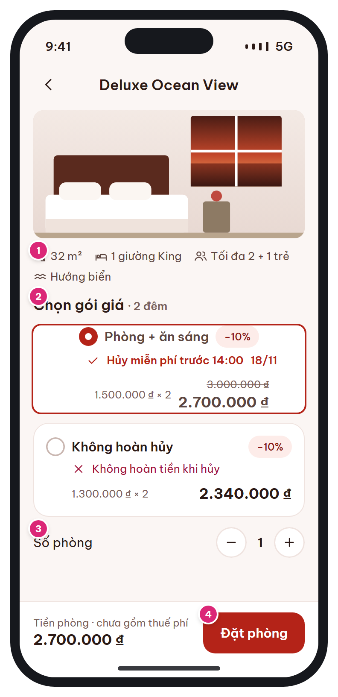

# MB-06 · Loại phòng & gói giá

[‹ MB-05](MB-05.md) · [Danh sách](../README.md) · [MB-07 ›](MB-07.md)

**Luồng:** Tìm & chọn phòng · **Route:** `/hotels/:id/rooms/:roomTypeId` · **Quyền:** Guest / Member

Xem chi tiết loại phòng, chọn gói giá (chính sách hủy hiện ngay trên thẻ) và số phòng.

> Ghi chú thiết kế: Mỗi gói giá là một thẻ chọn; chính sách hủy hiện ngay trên thẻ.

| Thiết kế | Có số chú thích |
| :---: | :---: |
|  |  |

## 1. Bố cục

- Header: back + tên loại phòng.
- Ảnh phòng + hàng thông số (diện tích, giường, sức chứa, hướng).
- Section 'Chọn gói giá · N đêm': danh sách card radio.
- Stepper số phòng.
- Bottom bar: tổng tiền phòng + nút Đặt phòng.

## 2. Hạng mục màn hình (画面項目定義)

Cột **No** trùng với số hồng trên ảnh có chú thích.

| No | Hạng mục | Loại UI | Dữ liệu / nguồn | Ràng buộc / validate | Hành động |
| --- | --- | --- | --- | --- | --- |
| 1 | Thông số phòng | Hàng chip icon | room_types.area_m2, bed_type, max_adults, max_children, view_type |  |  |
| 2 | Card gói giá | Card chọn (viền brand khi chọn) + radio | rate_plans: name, breakfast_included, price_adjust_*, cancellation_policies | Gói không thỏa min_nights / advance_days_min: ẩn | Chạm chọn gói; mặc định gói rẻ nhất có hủy miễn phí |
| – | Dòng chính sách hủy | Icon check (brand) / close (rose) + text | cancellation_policies.is_refundable, free_cancel_hours | Hạn hủy = (check_in_date + check_in_time) − free_cancel_hours (BR-06) |  |
| – | Giá gói | "{giá đêm} × {n}" + gạch tổng gốc + tổng sau KM | BR-02 / BR-03② | Làm tròn 1.000₫ |  |
| 3 | Số phòng | Stepper (nút 36, vùng chạm 44) | rooms | 1 … min(5, rooms_left) | Đổi → cập nhật tổng |
| 4 | Đặt phòng | Primary button trong bottom bar |  | Phải chọn 1 gói | Guest → [MB-02](MB-02.md) (returnTo=[MB-07](MB-07.md)); Member → [MB-07](MB-07.md) |
| – | Tổng tiền phòng | Text price + "chưa gồm thuế phí" | Σ giá đêm × số phòng − KM |  |  |

## 3. API

| Method | Endpoint | Ghi chú |
| --- | --- | --- |
| (dùng lại) | `/api/v1/hotels/{id}/availability` | Response MB-05 đã chứa rate_plans; không gọi lại trừ khi đổi số phòng vượt rooms_left |

## 4. Trạng thái màn hình

| Trạng thái | Hiển thị / xử lý |
| --- | --- |
| Giá thay đổi khi quay lại | Toast amber "Giá đã được cập nhật" |
| Hết phòng trong lúc xem | Disable nút + toast rose, gợi ý quay lại [MB-05](MB-05.md) |

## 5. Quy tắc nghiệp vụ

- BR-02 tính giá đêm; BR-03② KM tự động chỉ trên tiền phòng; BR-06 hạn hủy miễn phí; gói Non-refundable: phí = 100%.

## 6. Điều hướng

| Thao tác | Màn đích |
| --- | --- |
| Back | [MB-05](MB-05.md) |
| Đặt phòng | [MB-07](MB-07.md) (hoặc [MB-02](MB-02.md) nếu guest) |

## 7. i18n key gợi ý

`rate.choose {nights}` · `rate.freeCancelUntil {time} {date}` · `rate.nonRefundable` · `rate.breakfast` · `rate.perNightTimes {price} {n}` · `booking.roomCount` · `booking.roomTotalExclTax` · `booking.book`

## 8. Gợi ý triển khai Flutter

- RadioListTile tùy biến hoặc GestureDetector + AnimatedContainer viền
- bookingDraftProvider lưu {hotel, roomType, ratePlan, rooms, dates, guests} dùng tiếp ở MB-07/08

---

[‹ MB-05](MB-05.md) · [Danh sách](../README.md) · [MB-07 ›](MB-07.md)
