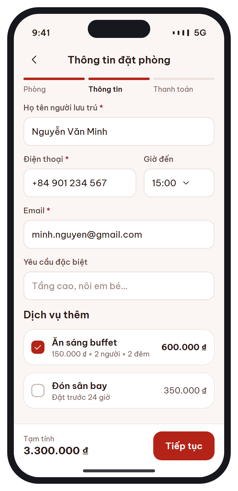
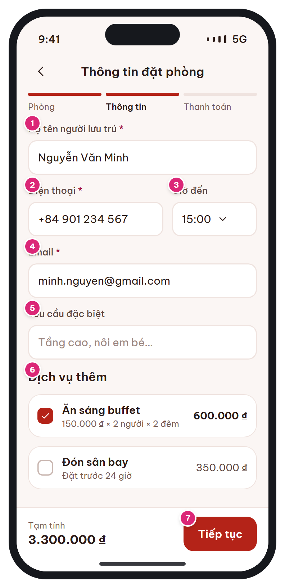

# MB-07 · Thông tin khách & dịch vụ thêm

[‹ MB-06](MB-06.md) · [Danh sách](../README.md) · [MB-08 ›](MB-08.md)

**Luồng:** Đặt & thanh toán · **Route:** `/booking/guest` · **Quyền:** Member

Bước 2/3: nhập thông tin người lưu trú (điền sẵn từ hồ sơ) và chọn dịch vụ thêm.

> Ghi chú thiết kế: Điền sẵn từ hồ sơ; validate khi rời ô.

| Thiết kế | Có số chú thích |
| :---: | :---: |
|  |  |

## 1. Bố cục

- Header: back + 'Thông tin đặt phòng'.
- Thanh bước 3 đoạn (Phòng ✓ · Thông tin • · Thanh toán).
- Form 5 trường.
- Section Dịch vụ thêm: card checkbox.
- Bottom bar: Tạm tính + Tiếp tục.

## 2. Hạng mục màn hình (画面項目定義)

Cột **No** trùng với số hồng trên ảnh có chú thích.

| No | Hạng mục | Loại UI | Dữ liệu / nguồn | Ràng buộc / validate | Hành động |
| --- | --- | --- | --- | --- | --- |
| 1 | Họ tên người lưu trú * | Text input | bookings.guest_name ← users.full_name | Bắt buộc, ≤ 100 ký tự | Validate khi rời ô |
| 2 | Điện thoại * | Phone input | bookings.guest_phone ← users.phone | Bắt buộc, E.164 |  |
| 3 | Giờ đến | Dropdown (icon down) | bookings.estimated_arrival | Tùy chọn; mốc 30 phút từ giờ check-in đến 23:30 | Mở picker |
| 4 | Email * | Email input | bookings.guest_email ← users.email | Bắt buộc, email hợp lệ (gửi xác nhận) |  |
| 5 | Yêu cầu đặc biệt | Textarea 76px | bookings.special_request | ≤ 500 ký tự, có bộ đếm |  |
| 6 | Dịch vụ thêm | Card checkbox: tên, công thức giá, thành tiền | services (bookable_in_app, status ACTIVE) | Thành tiền theo unit (BR-12). Dịch vụ có lead_time_hours mà không còn kịp → disable + lý do | Chọn/bỏ; dịch vụ PER_TRIP/PER_ITEM có stepper số lượng |
| 7 | Tiếp tục | Primary button trong bottom bar |  | Form hợp lệ | POST /bookings (giữ phòng 15 phút) → [MB-08](MB-08.md) |
| – | Tạm tính | Text price | room_amount − promotion_discount + service_amount |  |  |

## 3. API

| Method | Endpoint | Ghi chú |
| --- | --- | --- |
| GET | `/api/v1/hotels/{id}/services` | Danh sách dịch vụ thêm |
| POST | `/api/v1/bookings` | Header Idempotency-Key. Body: hotel_id, dates, guests, rooms[{room_type_id, rate_plan_id, adults, children}], guest_*, estimated_arrival, special_request, services[{service_id, quantity, service_date}] → { booking_code, status: PENDING_PAYMENT, hold_expires_at, quote } |

## 4. Trạng thái màn hình

| Trạng thái | Hiển thị / xử lý |
| --- | --- |
| Lỗi validate | Viền rose + help text dưới ô, cuộn tới ô lỗi đầu tiên |
| Hết phòng khi tạo booking (409) | Dialog "Phòng vừa hết" → về [MB-05](MB-05.md) |
| Đang tạo | Spinner trên nút, chặn bấm lặp (Idempotency-Key) |

## 5. Quy tắc nghiệp vụ

- BR-04: tạo booking trong 1 transaction, khóa room_inventories, giữ 15 phút (hold_expires_at).
- BR-12: PER_PERSON × người × qty; PER_PERSON_NIGHT × người × đêm; PER_ROOM_NIGHT × phòng × đêm; PER_TRIP/PER_ITEM × qty.
- CẦN XÁC NHẬN: voucher/điểm được chọn ở [MB-08](MB-08.md) (sau khi đã giữ phòng). Đề xuất áp dụng voucher/điểm khi gọi /payments thay vì lúc tạo booking.

## 6. Điều hướng

| Thao tác | Màn đích |
| --- | --- |
| Back | [MB-06](MB-06.md) (giữ dữ liệu) |
| Tiếp tục | [MB-08](MB-08.md) |

## 7. i18n key gợi ý

`booking.step.room` · `booking.step.info` · `booking.step.payment` · `guest.name` · `guest.phone` · `guest.arrival` · `guest.email` · `guest.request` · `service.title` · `service.formula.perPersonNight {price} {persons} {nights}` · `service.leadTime {hours}` · `booking.subtotal` · `common.continue`

## 8. Gợi ý triển khai Flutter

- Form + GlobalKey<FormState>; focus tiếp theo bằng textInputAction.next
- Stepper dạng 3 thanh: widget StepBar(current: 1)

---

[‹ MB-06](MB-06.md) · [Danh sách](../README.md) · [MB-08 ›](MB-08.md)
