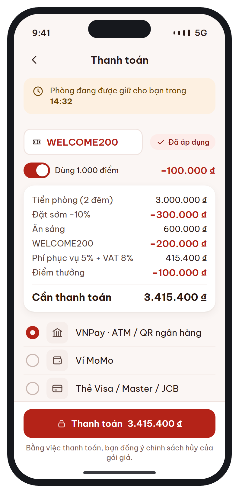
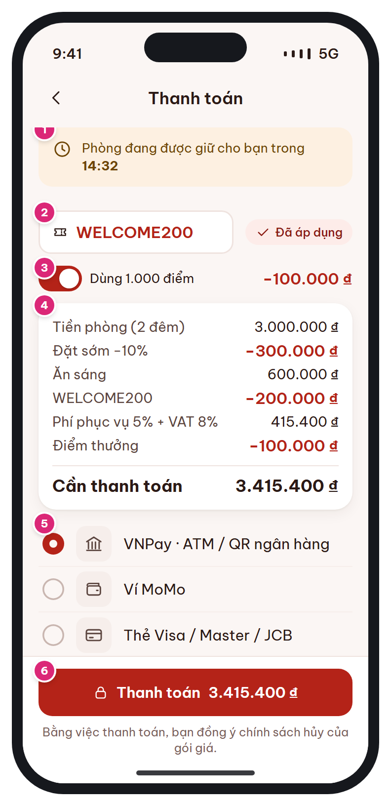

# MB-08 · Xác nhận & thanh toán

[‹ MB-07](MB-07.md) · [Danh sách](../README.md) · [MB-08e ›](MB-08e.md)

**Luồng:** Đặt & thanh toán · **Route:** `/booking/:code/payment` · **Quyền:** Member

Bước 3/3: áp voucher / điểm, xem chi tiết giá, chọn phương thức và thanh toán trong thời gian giữ phòng 15 phút.

> Ghi chú thiết kế: Đồng hồ giữ phòng 15 phút; giá tính lại qua API quote khi đổi voucher/điểm.

| Thiết kế | Có số chú thích |
| :---: | :---: |
|  |  |

## 1. Bố cục

- Header: back + 'Thanh toán'.
- Toast amber đồng hồ giữ phòng + tóm tắt đặt phòng.
- Ô voucher, dòng dùng điểm (switch).
- Card chi tiết giá.
- Danh sách phương thức thanh toán (radio).
- Bottom bar: nút Thanh toán {số tiền} + điều khoản.

## 2. Hạng mục màn hình (画面項目定義)

Cột **No** trùng với số hồng trên ảnh có chú thích.

| No | Hạng mục | Loại UI | Dữ liệu / nguồn | Ràng buộc / validate | Hành động |
| --- | --- | --- | --- | --- | --- |
| 1 | Đồng hồ giữ phòng | Toast amber + icon clock, mm:ss | bookings.hold_expires_at (theo giờ server) | ≤ 2 phút: đổi sang toast rose | Hết giờ → dialog "Hết thời gian giữ phòng" → [MB-05](MB-05.md) |
| 2 | Voucher | Input + trạng thái "Đã áp dụng" | vouchers.code | Điều kiện BR-10; lỗi hiện lý do (chưa đến ngày, đơn tối thiểu, sai chi nhánh, hạng…) | Chạm → [MB-14](MB-14.md) (chế độ chọn) hoặc nhập mã → validate → quote |
| 3 | Dùng điểm | Row + switch + số tiền trừ | users.point_balance | points_used ≤ balance và points_amount ≤ 50% total_amount; 1 điểm = 100₫ | Bật/tắt → quote |
| 4 | Chi tiết giá | Card kv rows; dòng tổng t-m bold | Kết quả quote | Thứ tự BR-03: tiền phòng, KM, dịch vụ, voucher, phí phục vụ + VAT, điểm, Cần thanh toán |  |
| 5 | Phương thức thanh toán | List-row radio: VNPay, MoMo, Thẻ (Stripe) | payments.method | Mặc định phương thức dùng lần trước |  |
| 6 | Nút Thanh toán | Primary + icon lock + số tiền | payable_amount | Disable khi quote đang tính | POST /payments → mở pay_url → chờ kết quả |

## 3. API

| Method | Endpoint | Ghi chú |
| --- | --- | --- |
| POST | `/api/v1/bookings/quote` | { booking_code, voucher_code?, points_used? } → { room_amount, promotion_discount, service_amount, voucher_discount, service_charge, tax_amount, total_amount, points_amount, payable_amount }  (debounce 300ms) |
| POST | `/api/v1/vouchers/validate` | { code, booking_code } → hợp lệ / lý do |
| POST | `/api/v1/bookings/{code}/payments` | { method, return_url } → { payment_code, pay_url }; payable=0 → CONFIRMED ngay |
| GET | `/api/v1/bookings/{code}` | Poll 2s (tối đa 60s) sau khi quay lại từ cổng TT để đọc status |

## 4. Trạng thái màn hình

| Trạng thái | Hiển thị / xử lý |
| --- | --- |
| Đang tính lại giá | Shimmer dòng tổng, disable nút |
| Quay lại từ cổng – đang xác nhận | Màn chờ "Đang xác nhận thanh toán…" |
| Thất bại / hủy ở cổng | [MB-08e](MB-08e.md) |
| Thành công | [MB-09](MB-09.md) |

## 5. Quy tắc nghiệp vụ

- BR-03 thứ tự tính tổng; BR-05: kết quả chỉ tin theo IPN/webhook, redirect chỉ để hiển thị.
- BR-04: đồng hồ 15 phút; quá hạn BAT01 chuyển EXPIRED.
- Ví dụ chuẩn trong Basic Design: 3.000.000 − 300.000 + 600.000 − 200.000 → +5% +8% − 100.000 = 3.415.400₫.

## 6. Điều hướng

| Thao tác | Màn đích |
| --- | --- |
| Back | [MB-07](MB-07.md) (booking vẫn giữ) |
| Voucher | [MB-14](MB-14.md) (select mode) |
| Thanh toán OK | [MB-09](MB-09.md) |
| Thanh toán lỗi | [MB-08e](MB-08e.md) |

## 7. i18n key gợi ý

`payment.holdTimer {time}` · `payment.voucher` · `payment.voucherApplied` · `payment.usePoints {points}` · `price.room {nights}` · `price.promotion` · `price.serviceTaxes {sc} {vat}` · `price.points` · `price.payable` · `payment.method.vnpay` · `payment.method.momo` · `payment.method.card` · `payment.pay {amount}` · `payment.terms`

## 8. Gợi ý triển khai Flutter

- webview_flutter cho VNPay/Stripe; url_launcher (externalApplication) cho MoMo app
- app_links bắt deep link vivustay://payment/result
- Đồng bộ đồng hồ: offset = serverTime (header Date) − DateTime.now()

---

[‹ MB-07](MB-07.md) · [Danh sách](../README.md) · [MB-08e ›](MB-08e.md)
