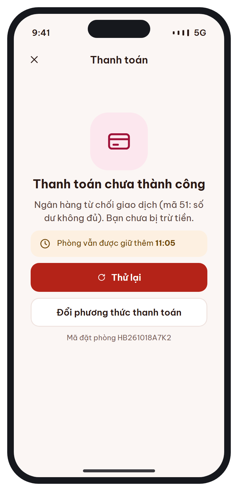
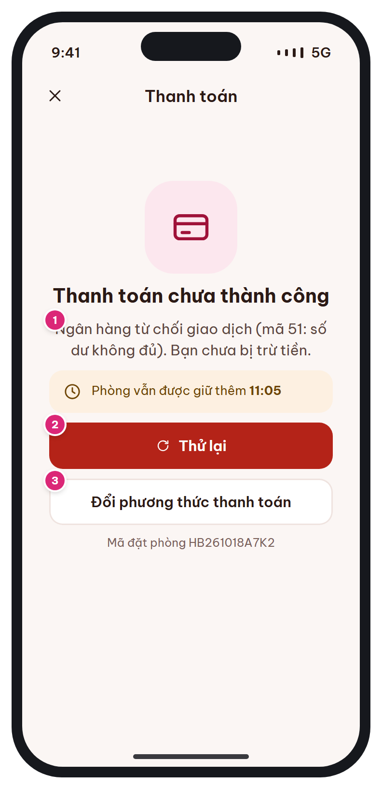

# MB-08e · Thanh toán thất bại

[‹ MB-08](MB-08.md) · [Danh sách](../README.md) · [MB-09 ›](MB-09.md)

**Luồng:** Đặt & thanh toán · **Route:** `/booking/:code/payment/failed` · **Quyền:** Member

Báo thanh toán không thành công, khẳng định chưa bị trừ tiền, giữ nguyên booking và đồng hồ; cho thử lại hoặc đổi phương thức.

> Ghi chú thiết kế: Giữ nguyên booking và đồng hồ; cho thử lại / đổi phương thức.

| Thiết kế | Có số chú thích |
| :---: | :---: |
|  |  |

## 1. Bố cục

- Header: X + 'Thanh toán'.
- Empty state icon card + tiêu đề + lý do.
- Toast amber đồng hồ còn lại.
- Nút Thử lại (primary), Đổi phương thức (secondary), mã đặt phòng.

## 2. Hạng mục màn hình (画面項目定義)

Cột **No** trùng với số hồng trên ảnh có chú thích.

| No | Hạng mục | Loại UI | Dữ liệu / nguồn | Ràng buộc / validate | Hành động |
| --- | --- | --- | --- | --- | --- |
| 1 | Lý do thất bại | Text t-b sec | payments.failure_reason (map mã cổng → câu thân thiện) | Luôn kèm câu "Bạn chưa bị trừ tiền" khi status=FAILED |  |
| – | Đồng hồ giữ phòng | Toast amber | hold_expires_at | Hết giờ → dialog hết hạn |  |
| 2 | Thử lại | Primary + icon refresh |  |  | POST /payments cùng method |
| 3 | Đổi phương thức thanh toán | Secondary |  |  | → [MB-08](MB-08.md) |
| – | Mã đặt phòng | Text t-xs sub | bookings.booking_code |  | Nhấn giữ để sao chép |

## 3. API

| Method | Endpoint | Ghi chú |
| --- | --- | --- |
| POST | `/api/v1/bookings/{code}/payments` | Tạo giao dịch mới (giao dịch cũ FAILED) |

## 4. Trạng thái màn hình

| Trạng thái | Hiển thị / xử lý |
| --- | --- |
| Không rõ kết quả (timeout) | Thông điệp "Đang chờ ngân hàng xác nhận" + nút Kiểm tra lại (GET booking); BAT07 đối soát |

## 5. Quy tắc nghiệp vụ

- BR-05; thông báo N-02 "Thanh toán thất bại / hết hạn giữ phòng" (Push).

## 6. Điều hướng

| Thao tác | Màn đích |
| --- | --- |
| X | [MB-11](MB-11.md) (booking PENDING_PAYMENT) |
| Thử lại thành công | [MB-09](MB-09.md) |
| Đổi phương thức | [MB-08](MB-08.md) |

## 7. i18n key gợi ý

`payment.failed.title` · `payment.failed.reason.{code}` · `payment.failed.notCharged` · `payment.holdLeft {time}` · `payment.retry` · `payment.changeMethod` · `booking.code {code}`

## 8. Gợi ý triển khai Flutter

- Map mã lỗi ở client: errors/payment_errors.dart (VNPay 24, 51, 65…)

---

[‹ MB-08](MB-08.md) · [Danh sách](../README.md) · [MB-09 ›](MB-09.md)
