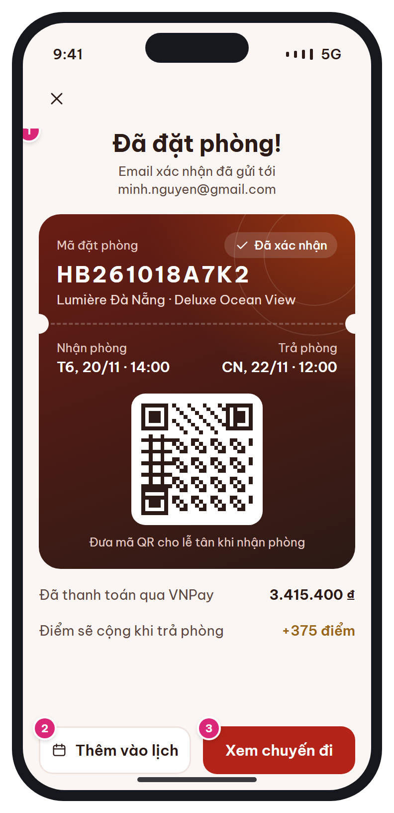

# MB-09 · Đặt phòng thành công

[‹ MB-08e](MB-08e.md) · [Danh sách](../README.md) · [MB-10 ›](MB-10.md)

**Luồng:** Đặt & thanh toán · **Route:** `/booking/:code/success` · **Quyền:** Member

Xác nhận đặt phòng thành công với 'thẻ chìa khóa' (mã + QR dùng khi check-in tại quầy).

> Ghi chú thiết kế: Thẻ chìa khóa: mã + QR dùng khi check-in tại quầy.

| Thiết kế | Có số chú thích |
| :---: | :---: |
|  |  |

## 1. Bố cục

- Header: X.
- Icon check + 'Đã đặt phòng!' + email đã gửi.
- Thẻ chìa khóa (key card): mã, trạng thái, khách sạn, ngày nhận/trả, vạch xé, QR, số tiền đã trả, điểm dự kiến.
- Nút Thêm vào lịch, Xem chuyến đi.

## 2. Hạng mục màn hình (画面項目定義)

Cột **No** trùng với số hồng trên ảnh có chú thích.

| No | Hạng mục | Loại UI | Dữ liệu / nguồn | Ràng buộc / validate | Hành động |
| --- | --- | --- | --- | --- | --- |
| 1 | Thẻ chìa khóa | Key card gradient (thành phần nổi bật duy nhất của app) | booking_code, status, hotel, room_type, check_in/out + giờ, paid_amount, payments.method, điểm dự kiến | Mã chữ 22px, letter-spacing 2 | Nhấn giữ mã để sao chép |
| – | QR | QR trắng 132px | Nội dung: booking_code (lễ tân quét ở AD-04) |  | Chạm → QR toàn màn hình, tăng độ sáng |
| – | Điểm dự kiến | Text "+{n} điểm" | floor(thực trả trước thuế / 10.000) × hệ số hạng (BR-08) | Ghi rõ: cộng khi trả phòng |  |
| 2 | Thêm vào lịch | Secondary + icon calendar |  |  | add_2_calendar: tiêu đề, địa chỉ, check-in → check-out |
| 3 | Xem chuyến đi | Primary |  |  | → [MB-10](MB-10.md) (xóa stack đặt phòng) |

## 3. API

| Method | Endpoint | Ghi chú |
| --- | --- | --- |
| GET | `/api/v1/bookings/{code}` | Dữ liệu thẻ (đã có từ bước poll) |

## 4. Trạng thái màn hình

| Trạng thái | Hiển thị / xử lý |
| --- | --- |
| Mở lại từ thông báo N-01 | Vào [MB-11](MB-11.md) thay vì [MB-09](MB-09.md) |

## 5. Quy tắc nghiệp vụ

- N-01 Đặt phòng thành công: Push + Email khi CONFIRMED.
- BR-08 tích điểm khi CHECKED_OUT.

## 6. Điều hướng

| Thao tác | Màn đích |
| --- | --- |
| X | [MB-03](MB-03.md) |
| Xem chuyến đi | [MB-10](MB-10.md) |

## 7. i18n key gợi ý

`success.title` · `success.emailSent {email}` · `booking.code` · `booking.status.confirmed` · `booking.checkIn` · `booking.checkOut` · `booking.showQr` · `booking.paidVia {method}` · `booking.pointsLater {n}` · `success.addCalendar` · `success.viewTrips`

## 8. Gợi ý triển khai Flutter

- qr_flutter; screen_brightness khi phóng to QR
- Chặn back về MB-08: context.go thay vì push

---

[‹ MB-08e](MB-08e.md) · [Danh sách](../README.md) · [MB-10 ›](MB-10.md)
