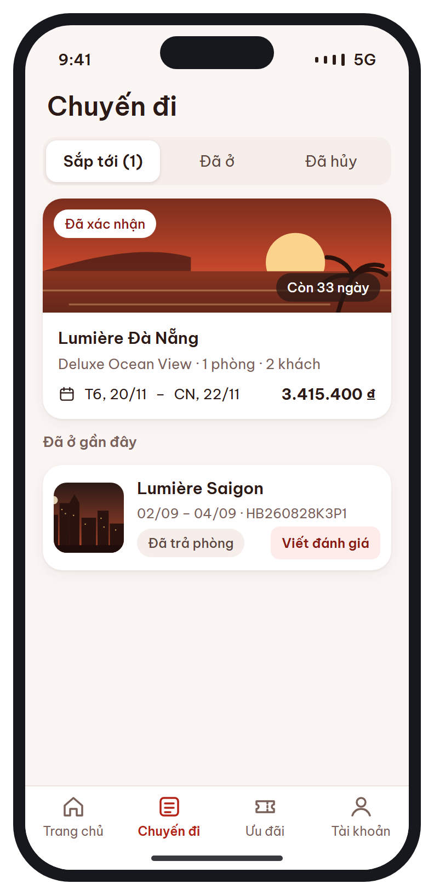
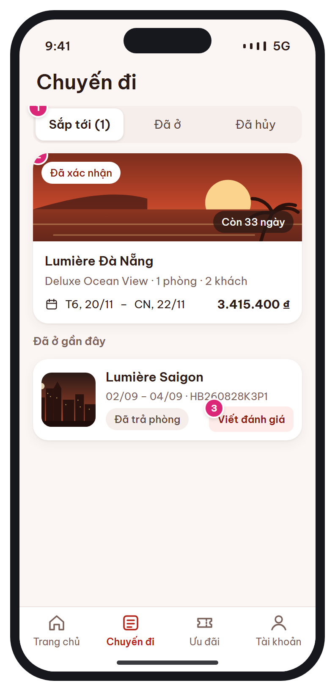

# MB-10 · Chuyến đi của tôi

[‹ MB-09](MB-09.md) · [Danh sách](../README.md) · [MB-11 ›](MB-11.md)

**Luồng:** Sau khi đặt · **Route:** `/trips  (tab 2)` · **Quyền:** Member

Danh sách đặt phòng theo 3 tab: Sắp tới / Đã ở / Đã hủy.

> Ghi chú thiết kế: 3 tab: Sắp tới / Đã ở / Đã hủy. Kéo xuống để làm mới.

| Thiết kế | Có số chú thích |
| :---: | :---: |
|  |  |

## 1. Bố cục

- Header lớn căn trái 'Chuyến đi'.
- Segmented 3 tab (kèm số lượng tab Sắp tới).
- Card booking sắp tới (ảnh, chip trạng thái, đếm ngày).
- Nhóm 'Đã ở gần đây' với nút Viết đánh giá.
- Tab bar.

## 2. Hạng mục màn hình (画面項目定義)

Cột **No** trùng với số hồng trên ảnh có chú thích.

| No | Hạng mục | Loại UI | Dữ liệu / nguồn | Ràng buộc / validate | Hành động |
| --- | --- | --- | --- | --- | --- |
| 1 | Segmented Sắp tới / Đã ở / Đã hủy | Segmented control | Sắp tới: PENDING_PAYMENT, CONFIRMED, CHECKED_IN · Đã ở: CHECKED_OUT, NO_SHOW · Đã hủy: CANCELLED, EXPIRED |  | Đổi tab → tải danh sách tương ứng |
| 2 | Card đặt phòng | Card: ảnh, chip trạng thái, "Còn N ngày", khách sạn, phòng · số phòng · khách, ngày, tổng tiền | bookings + booking_rooms | Màu chip theo bảng trạng thái (bên dưới) | → [MB-11](MB-11.md) |
| 3 | Viết đánh giá | Button sm ghost | reviews (chưa có cho booking) | Chỉ khi CHECKED_OUT, ≤ 30 ngày sau check-out, chưa đánh giá | → [MB-12](MB-12.md) |
| – | Chip trạng thái | Chip màu | bookings.status | PENDING_PAYMENT=amber "Chờ thanh toán" · CONFIRMED=brand "Đã xác nhận" · CHECKED_IN=sky "Đang ở" · CHECKED_OUT=chip thường "Đã trả phòng" · NO_SHOW/CANCELLED/EXPIRED=rose |  |

## 3. API

| Method | Endpoint | Ghi chú |
| --- | --- | --- |
| GET | `/api/v1/bookings?tab=upcoming\|past\|cancelled&page&size=20` | items[{booking_code, status, hotel{name, cover_url}, room_type_name, rooms, adults, children, check_in_date, check_out_date, total_amount, can_review}] |

## 4. Trạng thái màn hình

| Trạng thái | Hiển thị / xử lý |
| --- | --- |
| Đang tải | Skeleton 2 card |
| Rỗng (Sắp tới) | Empty state + nút "Tìm phòng" → [MB-03](MB-03.md) |
| Guest | Empty state + nút Đăng nhập |
| Kéo xuống | Pull-to-refresh |

## 5. Quy tắc nghiệp vụ

- Review v1→v2 #14: tab tên 'Chuyến đi' để không nhầm với nút 'Đặt phòng'.
- BR-11 điều kiện đánh giá.

## 6. Điều hướng

| Thao tác | Màn đích |
| --- | --- |
| Card | [MB-11](MB-11.md) |
| Viết đánh giá | [MB-12](MB-12.md) |

## 7. i18n key gợi ý

`trips.title` · `trips.tab.upcoming {count}` · `trips.tab.past` · `trips.tab.cancelled` · `trips.daysLeft {count}` · `trips.recentStays` · `trips.writeReview` · `booking.status.*`

## 8. Gợi ý triển khai Flutter

- RefreshIndicator + PagingController theo từng tab
- tripsProvider.family(tab)

---

[‹ MB-09](MB-09.md) · [Danh sách](../README.md) · [MB-11 ›](MB-11.md)
