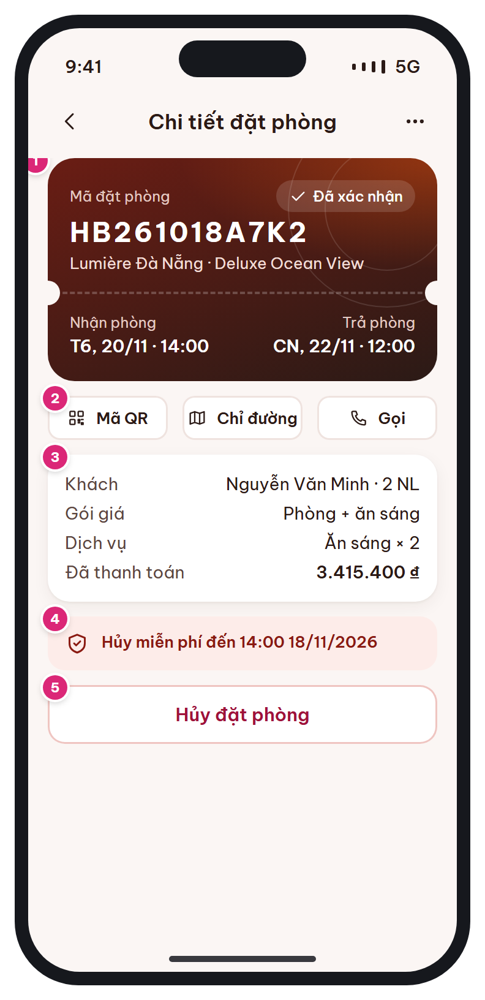

# MB-11 · Chi tiết đặt phòng

[‹ MB-10](MB-10.md) · [Danh sách](../README.md) · [MB-11c ›](MB-11c.md)

**Luồng:** Sau khi đặt · **Route:** `/trips/:code` · **Quyền:** Member

Toàn bộ thông tin một đặt phòng: thẻ chìa khóa, thao tác nhanh, thông tin khách / gói / dịch vụ / thanh toán, chính sách hủy.

> Ghi chú thiết kế: Nút Hủy chỉ hiện khi còn được hủy (BR-06).

| Thiết kế | Có số chú thích |
| :---: | :---: |
|  |  |

## 1. Bố cục

- Header: back + tiêu đề + nút more.
- Thẻ chìa khóa (như [MB-09](MB-09.md), không QR to).
- 3 nút nhanh: Mã QR · Chỉ đường · Gọi.
- Card thông tin (kv rows).
- Toast chính sách hủy, nút Hủy đặt phòng (danger).

## 2. Hạng mục màn hình (画面項目定義)

Cột **No** trùng với số hồng trên ảnh có chú thích.

| No | Hạng mục | Loại UI | Dữ liệu / nguồn | Ràng buộc / validate | Hành động |
| --- | --- | --- | --- | --- | --- |
| 1 | Thẻ chìa khóa | Key card | bookings.* |  |  |
| – | Menu more | Icon button |  |  | Sheet: Chia sẻ, Liên hệ hỗ trợ, Tải xác nhận (PDF – giai đoạn sau) |
| 2 | Thao tác nhanh | 3 button sm secondary | booking_code; hotels.latitude/longitude; hotels.phone |  | QR toàn màn hình · mở Google/Apple Maps · gọi tel: |
| 3 | Thông tin | Card kv rows | guest_name + adults; rate_plans.name; booking_services; paid_amount |  |  |
| 4 | Chính sách hủy | Toast brand + icon shield | cancel_policy_snapshot | Hạn = check-in datetime − free_cancel_hours; quá hạn: toast amber "Hủy lúc này mất phí {fee}"; Non-refundable: toast rose |  |
| 5 | Hủy đặt phòng | Button danger full |  | CHỈ hiện khi status ∈ {PENDING_PAYMENT, CONFIRMED} và now < giờ check-in ngày đến (BR-06) | → [MB-11c](MB-11c.md) |
| – | Tiếp tục thanh toán | Primary (thay nút hủy khi PENDING_PAYMENT) | hold_expires_at |  | → [MB-08](MB-08.md) |

## 3. API

| Method | Endpoint | Ghi chú |
| --- | --- | --- |
| GET | `/api/v1/bookings/{code}` | Chi tiết đầy đủ + can_cancel, free_cancel_until |

## 4. Trạng thái màn hình

| Trạng thái | Hiển thị / xử lý |
| --- | --- |
| CANCELLED | Chip rose, ẩn QR & thao tác, hiện card hoàn tiền (refunds.status, số tiền) |
| CHECKED_OUT | Hiện nút Viết đánh giá (nếu đủ điều kiện) |
| Đang tải | Skeleton key card |

## 5. Quy tắc nghiệp vụ

- BR-06: không cho hủy khi CHECKED_IN hoặc sau giờ check-in ngày đến (chuyển quy trình no-show).
- Tính phí theo cancel_policy_snapshot, không theo chính sách hiện tại.

## 6. Điều hướng

| Thao tác | Màn đích |
| --- | --- |
| Back | [MB-10](MB-10.md) |
| Hủy đặt phòng | [MB-11c](MB-11c.md) |
| Tiếp tục thanh toán | [MB-08](MB-08.md) |

## 7. i18n key gợi ý

`bookingDetail.title` · `bookingDetail.qr` · `bookingDetail.directions` · `bookingDetail.call` · `bookingDetail.guest` · `bookingDetail.ratePlan` · `bookingDetail.services` · `bookingDetail.paid` · `cancel.freeUntil {time} {date}` · `cancel.button`

## 8. Gợi ý triển khai Flutter

- url_launcher: tel:, https://maps.google.com/?q=lat,lng (Android) / maps://?q= (iOS)
- bookingDetailProvider.family(code) – invalidate sau khi hủy

---

[‹ MB-10](MB-10.md) · [Danh sách](../README.md) · [MB-11c ›](MB-11c.md)
