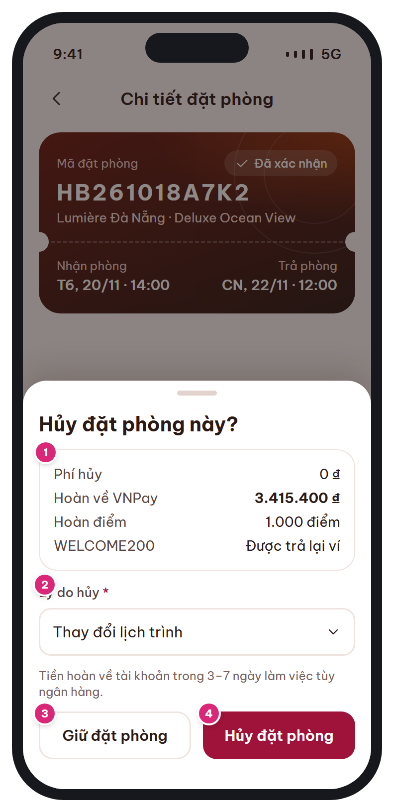

# MB-11c · Xác nhận hủy (bottom sheet)

[‹ MB-11](MB-11.md) · [Danh sách](../README.md) · [MB-12 ›](MB-12.md)

**Luồng:** Sau khi đặt · **Route:** `sheet trên /trips/:code` · **Quyền:** Member

Hiển thị phí hủy, tiền hoàn, điểm và voucher được trả lại (từ API cancel-preview) và bắt buộc chọn lý do trước khi hủy.

> Ghi chú thiết kế: Số liệu lấy từ API cancel-preview; bắt buộc chọn lý do.

| Thiết kế | Có số chú thích |
| :---: | :---: |
|  |  |

## 1. Bố cục

- Scrim trên [MB-11](MB-11.md).
- Sheet: tiêu đề câu hỏi → card số liệu → chọn lý do → ghi chú hoàn tiền → 2 nút (Giữ bên trái, Hủy bên phải).

## 2. Hạng mục màn hình (画面項目定義)

Cột **No** trùng với số hồng trên ảnh có chú thích.

| No | Hạng mục | Loại UI | Dữ liệu / nguồn | Ràng buộc / validate | Hành động |
| --- | --- | --- | --- | --- | --- |
| 1 | Số liệu hủy | Card kv rows | cancel-preview: cancel_fee, refund_amount, refund_method, points_refund, voucher_returned | Phí 0 → hiện "0 ₫" màu brand |  |
| 2 | Lý do hủy * | Dropdown | bookings.cancel_reason | Bắt buộc. Danh sách: Thay đổi lịch trình / Tìm được giá tốt hơn / Đặt nhầm thông tin / Khác (mở ô nhập ≤ 500) |  |
| – | Ghi chú hoàn tiền | Text t-xs sub |  | "Tiền hoàn về tài khoản trong 3–7 ngày làm việc tùy ngân hàng" |  |
| 3 | Giữ đặt phòng | Secondary (bên trái – lựa chọn an toàn) |  |  | Đóng sheet |
| 4 | Hủy đặt phòng | Danger |  | Disable đến khi chọn lý do | POST /cancel → toast "Đã hủy" → [MB-11](MB-11.md) cập nhật |

## 3. API

| Method | Endpoint | Ghi chú |
| --- | --- | --- |
| GET | `/api/v1/bookings/{code}/cancel-preview` | Gọi khi mở sheet |
| POST | `/api/v1/bookings/{code}/cancel` | { reason } → booking CANCELLED, refunds PENDING (1 transaction) |

## 4. Trạng thái màn hình

| Trạng thái | Hiển thị / xử lý |
| --- | --- |
| Đang tải preview | Skeleton card, disable nút Hủy |
| Preview khác lúc mở (409) | Tải lại preview + toast amber "Phí hủy đã thay đổi" |

## 5. Quy tắc nghiệp vụ

- §6.3: hủy → trả tồn kho, REVERT điểm, voucher_usages REVERTED, tạo refunds; worker hoàn tiền; gửi N-03.
- Review #7: nút an toàn 'Giữ đặt phòng' bên trái.

## 6. Điều hướng

| Thao tác | Màn đích |
| --- | --- |
| Giữ / vuốt xuống | Đóng về [MB-11](MB-11.md) |
| Hủy thành công | [MB-11](MB-11.md) (trạng thái CANCELLED) |

## 7. i18n key gợi ý

`cancel.title` · `cancel.fee` · `cancel.refundTo {method}` · `cancel.pointsBack` · `cancel.voucherBack` · `cancel.reason` · `cancel.reason.*` · `cancel.refundNote` · `cancel.keep` · `cancel.confirm`

## 8. Gợi ý triển khai Flutter

- showModalBottomSheet; FutureProvider cancelPreview(code)
- Sau khi hủy: ref.invalidate(bookingDetailProvider(code)), ref.invalidate(tripsProvider)

---

[‹ MB-11](MB-11.md) · [Danh sách](../README.md) · [MB-12 ›](MB-12.md)
