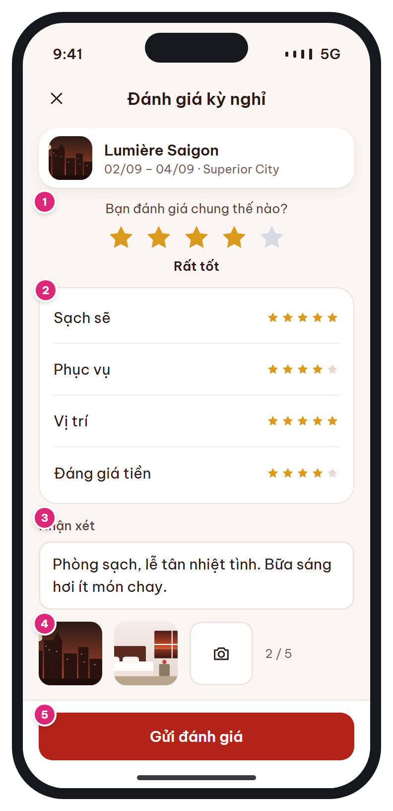

# MB-12 · Viết đánh giá

[‹ MB-11c](MB-11c.md) · [Danh sách](../README.md) · [MB-13 ›](MB-13.md)

**Luồng:** Sau khi đặt · **Route:** `/trips/:code/review` · **Quyền:** Member

Chấm điểm chung + 4 tiêu chí, viết nhận xét, đính kèm tối đa 5 ảnh. Nhận 50 điểm khi được duyệt.

> Ghi chú thiết kế: Chỉ khi đã trả phòng ≤ 30 ngày. Nhận 50 điểm khi được duyệt.

| Thiết kế | Có số chú thích |
| :---: | :---: |
|  |  |

## 1. Bố cục

- Header: X + 'Đánh giá kỳ nghỉ'.
- Card tóm tắt booking.
- Card điểm chung (5 sao lớn + nhãn).
- Card 4 tiêu chí (list-row + sao).
- Ô nhận xét, ô thêm ảnh.
- Bottom bar: Gửi đánh giá.

## 2. Hạng mục màn hình (画面項目定義)

Cột **No** trùng với số hồng trên ảnh có chú thích.

| No | Hạng mục | Loại UI | Dữ liệu / nguồn | Ràng buộc / validate | Hành động |
| --- | --- | --- | --- | --- | --- |
| – | Tóm tắt kỳ nghỉ | Card nhỏ: ảnh, khách sạn, ngày, loại phòng | bookings, hotels, room_types |  |  |
| 1 | Điểm chung * | 5 sao 36px + nhãn | reviews.rating_overall | Bắt buộc 1–5. Nhãn: Tệ / Tạm / Ổn / Rất tốt / Tuyệt vời | Chạm sao |
| 2 | Điểm tiêu chí | 4 list-row: Sạch sẽ, Phục vụ, Vị trí, Đáng giá tiền | rating_cleanliness, rating_service, rating_location, rating_value | Tùy chọn 1–5 |  |
| 3 | Nhận xét | Textarea + bộ đếm | reviews.comment | Tùy chọn, ≤ 2000 ký tự |  |
| 4 | Ảnh | Ô thêm ảnh + thumbnail, bộ đếm n / 5 | review_images.url | ≤ 5 ảnh, ≤ 5MB/ảnh (nén client về ≤ 2048px) | Chọn từ thư viện / chụp |
| 5 | Gửi đánh giá | Primary trong bottom bar |  | Disable khi chưa có điểm chung | Upload ảnh → POST review → toast + quay về [MB-10](MB-10.md) |

## 3. API

| Method | Endpoint | Ghi chú |
| --- | --- | --- |
| POST | `/api/v1/bookings/{code}/review` | multipart: rating_*, comment, images[] (hoặc ĐỀ XUẤT: presigned S3 URL rồi gửi url) |

## 4. Trạng thái màn hình

| Trạng thái | Hiển thị / xử lý |
| --- | --- |
| Đã đánh giá (409) | Dialog "Bạn đã đánh giá kỳ nghỉ này" |
| Quá 30 ngày | Không vào được màn; nút ở [MB-10](MB-10.md) ẩn |
| Đang upload | Progress trên từng ảnh |

## 5. Quy tắc nghiệp vụ

- BR-11: chỉ booking CHECKED_OUT, ≤ 30 ngày sau check-out, 1 review/booking, review PENDING → admin duyệt.
- BR-08: +50 điểm khi PUBLISHED (1 lần/booking).

## 6. Điều hướng

| Thao tác | Màn đích |
| --- | --- |
| X | [MB-10](MB-10.md) (hỏi xác nhận nếu đã nhập) |
| Gửi | [MB-10](MB-10.md) + toast |

## 7. i18n key gợi ý

`review.title` · `review.overallQuestion` · `review.label.1..5` · `review.cleanliness` · `review.service` · `review.location` · `review.value` · `review.comment` · `review.photos {n}` · `review.submit` · `review.thanks`

## 8. Gợi ý triển khai Flutter

- image_picker + flutter_image_compress
- Widget StarRating(value, onChanged, size)

---

[‹ MB-11c](MB-11c.md) · [Danh sách](../README.md) · [MB-13 ›](MB-13.md)
