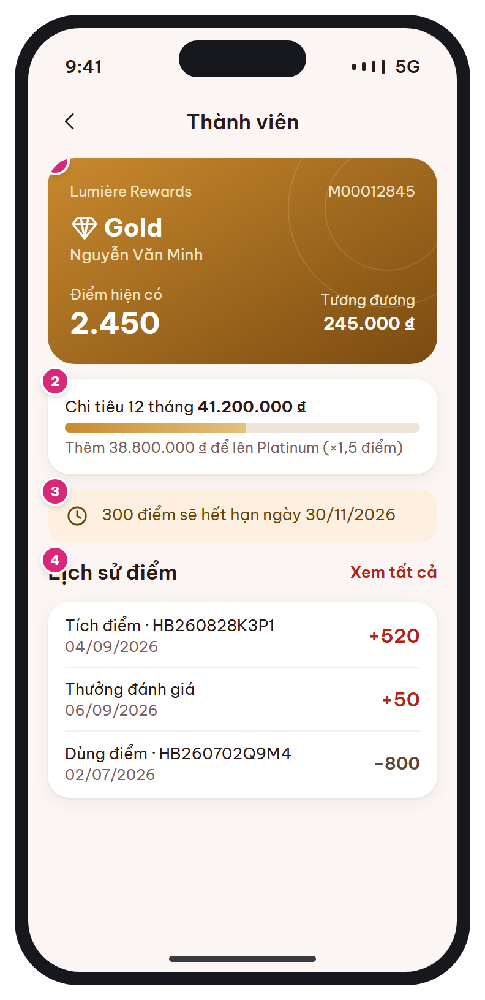

# MB-13 · Thành viên & điểm

[‹ MB-12](MB-12.md) · [Danh sách](../README.md) · [MB-14 ›](MB-14.md)

**Luồng:** Thành viên & cài đặt · **Route:** `/account/membership` · **Quyền:** Member

Thẻ thành viên, tiến độ lên hạng theo chi tiêu 12 tháng, điểm sắp hết hạn và lịch sử điểm.

> Ghi chú thiết kế: Thanh tiến độ tính theo chi tiêu 12 tháng.

| Thiết kế | Có số chú thích |
| :---: | :---: |
|  |  |

## 1. Bố cục

- Header: back + 'Thành viên'.
- Thẻ thành viên (key card): mã thành viên, hạng, tên, điểm, quy đổi tiền.
- Card tiến độ lên hạng (progress gold).
- Toast amber điểm sắp hết hạn.
- Lịch sử điểm (3 dòng gần nhất) + Xem tất cả.

## 2. Hạng mục màn hình (画面項目定義)

Cột **No** trùng với số hồng trên ảnh có chú thích.

| No | Hạng mục | Loại UI | Dữ liệu / nguồn | Ràng buộc / validate | Hành động |
| --- | --- | --- | --- | --- | --- |
| 1 | Thẻ thành viên | Key card | users.member_code, member_tiers.name_vi/ja, users.full_name, users.point_balance | Quy đổi = point_balance × 100₫ |  |
| 2 | Tiến độ lên hạng | Card + progress bar gold | users.spending_12m, member_tiers kế tiếp (min_spending_12m, point_multiplier) | Hạng cao nhất (PLATINUM): ẩn progress, hiện "Bạn đang ở hạng cao nhất" |  |
| 3 | Điểm sắp hết hạn | Toast amber + icon clock | Σ remaining các lô EARN có expires_at ≤ 30 ngày tới | Ẩn khi = 0 | Chạm → [MB-03](MB-03.md) (gợi ý dùng điểm) |
| 4 | Lịch sử điểm | Card list-row: loại · mã booking, ngày, ±điểm | point_transactions (type, points, booking_id, created_at) | + màu brand, − màu ink-2 | Xem tất cả → danh sách phân trang |

## 3. API

| Method | Endpoint | Ghi chú |
| --- | --- | --- |
| GET | `/api/v1/me/points` | { balance, tier, next_tier, spending_12m, expiring {points, date}, transactions[] (page) } |

## 4. Trạng thái màn hình

| Trạng thái | Hiển thị / xử lý |
| --- | --- |
| Chưa có giao dịch | Empty nhỏ "Đặt phòng đầu tiên để tích điểm" |

## 5. Quy tắc nghiệp vụ

- BR-08: điểm = floor(thực trả trước thuế / 10.000) × hệ số; hạn 12 tháng; trừ FIFO.
- BR-09: MEMBER 0 → SILVER ≥ 10tr → GOLD ≥ 30tr → PLATINUM ≥ 80tr; hệ số 1.0 / 1.1 / 1.25 / 1.5; xét ngày 1 hằng tháng.

## 6. Điều hướng

| Thao tác | Màn đích |
| --- | --- |
| Back | [MB-16](MB-16.md) hoặc [MB-03](MB-03.md) |
| Xem tất cả | Lịch sử điểm (danh sách) |

## 7. i18n key gợi ý

`member.title` · `member.code` · `member.points` · `member.equivalent {amount}` · `member.spending12m` · `member.toNextTier {amount} {tier} {multiplier}` · `member.expiring {points} {date}` · `member.history` · `points.type.*`

## 8. Gợi ý triển khai Flutter

- LinearProgressIndicator tùy biến gradient (gold-hi → gold)
- Màu vàng đồng chỉ dùng cho hạng & điểm

---

[‹ MB-12](MB-12.md) · [Danh sách](../README.md) · [MB-14 ›](MB-14.md)
