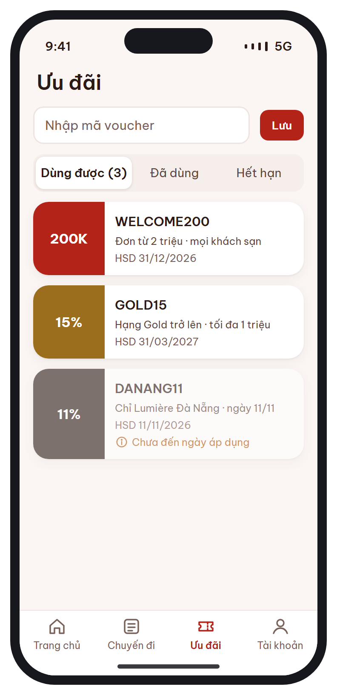
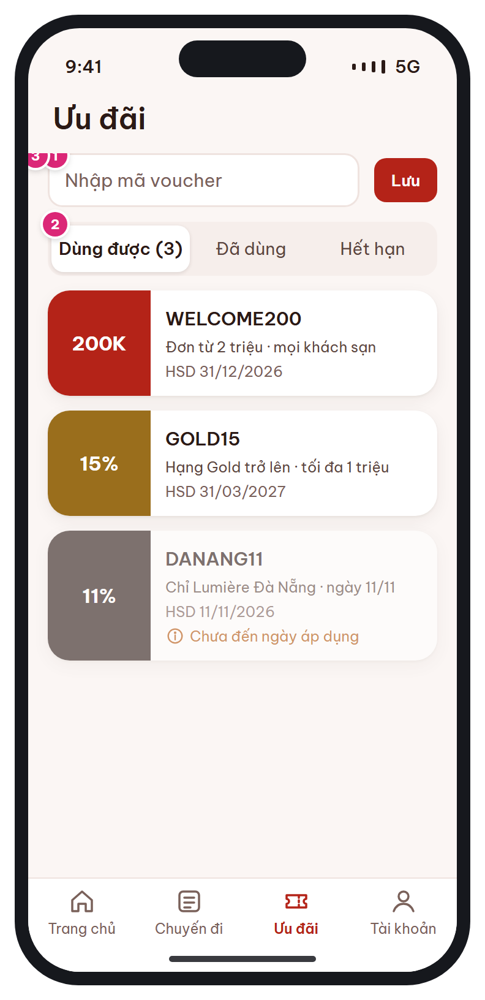

# MB-14 · Ví voucher

[‹ MB-13](MB-13.md) · [Danh sách](../README.md) · [MB-15 ›](MB-15.md)

**Luồng:** Thành viên & cài đặt · **Route:** `/offers  (tab 3) · /offers?select=1&booking=:code` · **Quyền:** Member

Lưu voucher bằng mã, xem voucher dùng được / đã dùng / hết hạn. Voucher không dùng được cho đơn hiện tại vẫn hiện kèm lý do.

> Ghi chú thiết kế: Voucher không dùng được cho đơn hiện tại vẫn hiện, kèm lý do.

| Thiết kế | Có số chú thích |
| :---: | :---: |
|  |  |

## 1. Bố cục

- Header lớn 'Ưu đãi'.
- Ô nhập mã + nút Lưu.
- Segmented 3 tab.
- Danh sách thẻ voucher (cuống trái hiện giá trị, phần phải chi tiết).
- Tab bar.

## 2. Hạng mục màn hình (画面項目定義)

Cột **No** trùng với số hồng trên ảnh có chú thích.

| No | Hạng mục | Loại UI | Dữ liệu / nguồn | Ràng buộc / validate | Hành động |
| --- | --- | --- | --- | --- | --- |
| 1 | Nhập mã voucher | Input + button sm | vouchers.code (không phân biệt hoa thường) | Mã tồn tại, ACTIVE, chưa lưu | Lưu → thêm vào user_vouchers (source=CODE) |
| 2 | Segmented Dùng được / Đã dùng / Hết hạn | Segmented (đếm số tab 1) | user_vouchers + voucher_usages + vouchers.end_at |  |  |
| – | Thẻ voucher | Card: cuống giá trị (200K / 15%), mã, điều kiện, HSD | discount_type, discount_value, max_discount, min_order_amount, hotel_id, min_tier_id, end_at | Không dùng được: mờ + dòng info lý do (chưa đến ngày, sai chi nhánh, chưa đủ hạng, chưa đủ đơn tối thiểu) | Chạm → sheet chi tiết; select mode: chọn & quay về [MB-08](MB-08.md) |
| 3 | Tab bar | Tab Ưu đãi đang chọn |  |  |  |

## 3. API

| Method | Endpoint | Ghi chú |
| --- | --- | --- |
| GET | `/api/v1/me/vouchers?status=usable\|used\|expired&booking_code?` | Khi có booking_code, server trả thêm usable_for_booking + reason |
| POST | `/api/v1/me/vouchers` | ĐỀ XUẤT BỔ SUNG: { code } → lưu voucher vào ví |

## 4. Trạng thái màn hình

| Trạng thái | Hiển thị / xử lý |
| --- | --- |
| Mã không hợp lệ | Help text rose dưới ô |
| Ví rỗng | Empty state + gợi ý nhập mã |

## 5. Quy tắc nghiệp vụ

- BR-10 điều kiện voucher; tối đa 1 voucher / booking; PERCENT bị giới hạn max_discount.

## 6. Điều hướng

| Thao tác | Màn đích |
| --- | --- |
| Chọn voucher (select mode) | pop về [MB-08](MB-08.md) với code |

## 7. i18n key gợi ý

`offers.title` · `offers.enterCode` · `offers.save` · `offers.tab.usable {count}` · `offers.tab.used` · `offers.tab.expired` · `voucher.minOrder {amount}` · `voucher.maxDiscount {amount}` · `voucher.expires {date}` · `voucher.reason.*`

## 8. Gợi ý triển khai Flutter

- ClipPath / CustomPainter cho răng cưa thẻ voucher
- vouchersProvider.family((status, bookingCode))

---

[‹ MB-13](MB-13.md) · [Danh sách](../README.md) · [MB-15 ›](MB-15.md)
