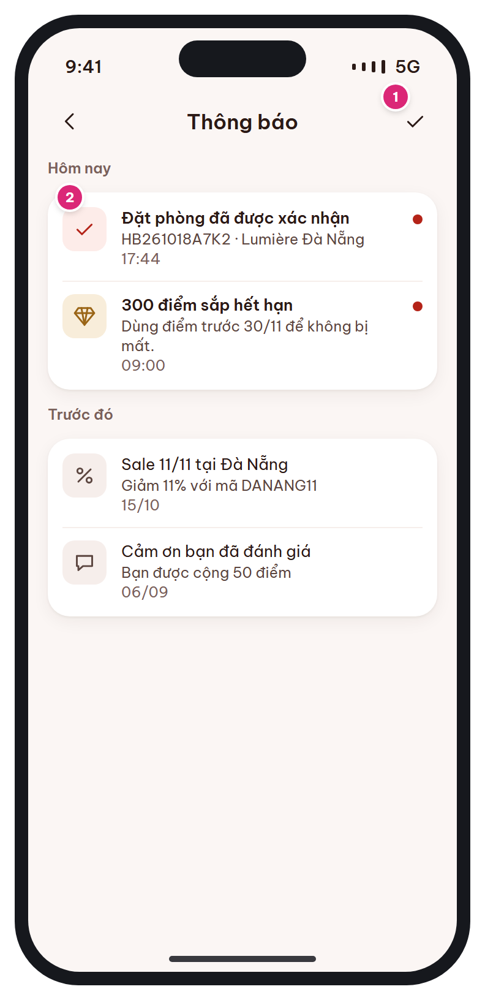

# MB-15 · Thông báo

[‹ MB-14](MB-14.md) · [Danh sách](../README.md) · [MB-16 ›](MB-16.md)

**Luồng:** Thành viên & cài đặt · **Route:** `/notifications` · **Quyền:** Member

Danh sách thông báo nhóm theo ngày; chạm mở màn liên quan (deep link), vuốt trái để xóa.

> Ghi chú thiết kế: Chạm thông báo → deep link tới màn liên quan; vuốt trái để xóa.

| Thiết kế | Có số chú thích |
| :---: | :---: |
|  |  |

## 1. Bố cục

- Header: back + 'Thông báo' + nút đánh dấu đã đọc tất cả.
- Nhóm 'Hôm nay' (card list-row).
- Nhóm 'Trước đó'.

## 2. Hạng mục màn hình (画面項目定義)

Cột **No** trùng với số hồng trên ảnh có chú thích.

| No | Hạng mục | Loại UI | Dữ liệu / nguồn | Ràng buộc / validate | Hành động |
| --- | --- | --- | --- | --- | --- |
| 1 | Đánh dấu đã đọc tất cả | Icon button check | notifications.is_read |  | PATCH read-all |
| 2 | Dòng thông báo | List-row: icon theo loại, tiêu đề (bold khi chưa đọc), nội dung 1–2 dòng, thời gian | notifications.type, title, body, data, is_read, created_at | Hôm nay: HH:mm; trước đó: ngày theo locale | Chạm → đánh dấu đã đọc + deep link theo data; vuốt trái → xóa |
| – | Bảng loại → icon → đích |  | BOOKING_CONFIRMED: check → [MB-11](MB-11.md) · PAYMENT_FAILED: card → [MB-08e](MB-08e.md) · BOOKING_CANCELLED: close → [MB-11](MB-11.md) · CHECKIN_REMINDER: cal → [MB-11](MB-11.md) · REVIEW_INVITE: chat → [MB-12](MB-12.md) · POINTS_EARNED / POINTS_EXPIRING: gem → [MB-13](MB-13.md) · TIER_UP: gem → [MB-13](MB-13.md) · PROMOTION: percent → [MB-14](MB-14.md) / banner link |  |  |

## 3. API

| Method | Endpoint | Ghi chú |
| --- | --- | --- |
| GET | `/api/v1/me/notifications?page&size=20` | items + unread_count |
| PATCH | `/api/v1/me/notifications/{id}/read · /read-all` | ĐỀ XUẤT BỔ SUNG |
| DELETE | `/api/v1/me/notifications/{id}` | ĐỀ XUẤT BỔ SUNG |

## 4. Trạng thái màn hình

| Trạng thái | Hiển thị / xử lý |
| --- | --- |
| Rỗng | Empty state "Chưa có thông báo" |
| Push khi app mở | In-app banner trên cùng 4s, chạm → deep link |

## 5. Quy tắc nghiệp vụ

- §11.2 danh sách thông báo N-01…N-09; push qua FCM (device_tokens).

## 6. Điều hướng

| Thao tác | Màn đích |
| --- | --- |
| Chạm thông báo | Theo bảng loại → đích |
| Back | [MB-03](MB-03.md) |

## 7. i18n key gợi ý

`notif.title` · `notif.markAllRead` · `notif.today` · `notif.earlier` · `notif.empty`

## 8. Gợi ý triển khai Flutter

- firebase_messaging + flutter_local_notifications
- Dismissible(direction: endToStart)
- Router xử lý deep link chung: DeepLinkHandler.open(data)

---

[‹ MB-14](MB-14.md) · [Danh sách](../README.md) · [MB-16 ›](MB-16.md)
