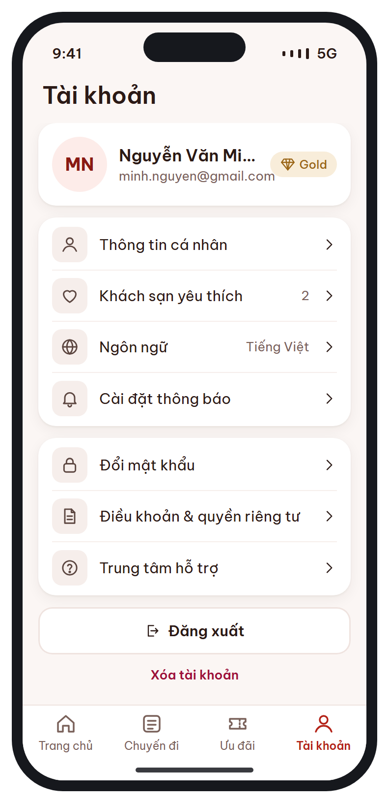
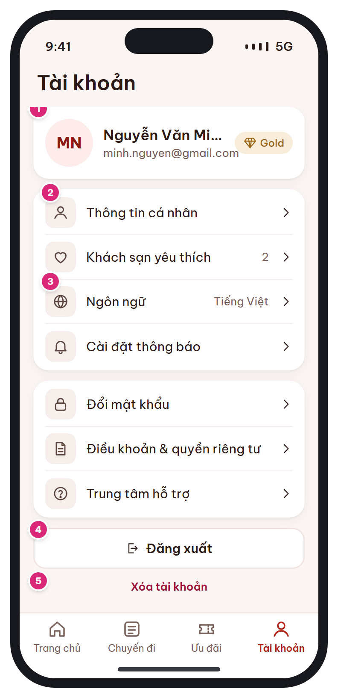

# MB-16 · Tài khoản

[‹ MB-15](MB-15.md) · [Danh sách](../README.md) · [MB-16b ›](MB-16b.md)

**Luồng:** Thành viên & cài đặt · **Route:** `/account  (tab 4)` · **Quyền:** Member (guest: CTA đăng nhập)

Hồ sơ, yêu thích, ngôn ngữ, cài đặt thông báo, đổi mật khẩu, điều khoản, hỗ trợ, đăng xuất, xóa tài khoản.

> Ghi chú thiết kế: Ngôn ngữ hiển thị giá trị hiện tại; chạm mở MB-16b.

| Thiết kế | Có số chú thích |
| :---: | :---: |
|  |  |

## 1. Bố cục

- Header lớn 'Tài khoản'.
- Card hồ sơ (avatar chữ cái, tên, email, chip hạng).
- Card nhóm 1: Thông tin cá nhân, Yêu thích, Ngôn ngữ, Cài đặt thông báo.
- Card nhóm 2: Đổi mật khẩu, Điều khoản, Hỗ trợ.
- Nút Đăng xuất, link Xóa tài khoản.
- Tab bar.

## 2. Hạng mục màn hình (画面項目定義)

Cột **No** trùng với số hồng trên ảnh có chú thích.

| No | Hạng mục | Loại UI | Dữ liệu / nguồn | Ràng buộc / validate | Hành động |
| --- | --- | --- | --- | --- | --- |
| 1 | Card hồ sơ | Avatar 56 (chữ cái đầu) + tên + email + chip gold hạng | users.full_name, email, avatar_url, member_tiers |  | → Thông tin cá nhân |
| 2 | Thông tin cá nhân / Yêu thích | List-row + chevron (Yêu thích có số đếm) | users.*; favorites count |  | → Sửa hồ sơ (PATCH /me) · Danh sách yêu thích |
| 3 | Ngôn ngữ | List-row hiển thị giá trị hiện tại | users.language |  | → [MB-16b](MB-16b.md) |
| – | Cài đặt thông báo, Đổi mật khẩu, Điều khoản, Hỗ trợ | List-row |  | Đổi mật khẩu ẩn với tài khoản chỉ đăng nhập social | Màn con / WebView |
| 4 | Đăng xuất | Button secondary + icon |  | Dialog xác nhận | Thu hồi refresh token, xóa device_token, xóa secure storage → [MB-03](MB-03.md) (guest) |
| 5 | Xóa tài khoản | Text link rose |  | Xác nhận 2 bước (nhập mật khẩu/OTP); chặn nếu còn booking sắp tới | DELETE /me → ẩn danh hóa dữ liệu (NĐ 13/2023) |

## 3. API

| Method | Endpoint | Ghi chú |
| --- | --- | --- |
| GET | `/api/v1/me` | Hồ sơ |
| PATCH | `/api/v1/me` | Sửa hồ sơ / ngôn ngữ |
| POST | `/api/v1/auth/logout` | ĐỀ XUẤT BỔ SUNG: thu hồi refresh token + device token |
| DELETE | `/api/v1/me` | ĐỀ XUẤT BỔ SUNG: xóa tài khoản (ẩn danh hóa) |

## 4. Trạng thái màn hình

| Trạng thái | Hiển thị / xử lý |
| --- | --- |
| Guest | Card hồ sơ thay bằng CTA Đăng nhập / Đăng ký; ẩn Đăng xuất, Xóa TK; vẫn đổi được Ngôn ngữ |

## 5. Quy tắc nghiệp vụ

- NFR §12: cho phép xóa tài khoản, ẩn danh hóa dữ liệu booking (NĐ 13/2023).

## 6. Điều hướng

| Thao tác | Màn đích |
| --- | --- |
| Ngôn ngữ | [MB-16b](MB-16b.md) |
| Chip hạng | [MB-13](MB-13.md) |
| Đăng xuất | [MB-03](MB-03.md) |

## 7. i18n key gợi ý

`account.title` · `account.profile` · `account.favorites {count}` · `account.language` · `account.notifications` · `account.changePassword` · `account.terms` · `account.help` · `account.logout` · `account.delete`

## 8. Gợi ý triển khai Flutter

- ListTile nhóm trong Card; showDialog xác nhận đăng xuất (adaptive)

---

[‹ MB-15](MB-15.md) · [Danh sách](../README.md) · [MB-16b ›](MB-16b.md)
