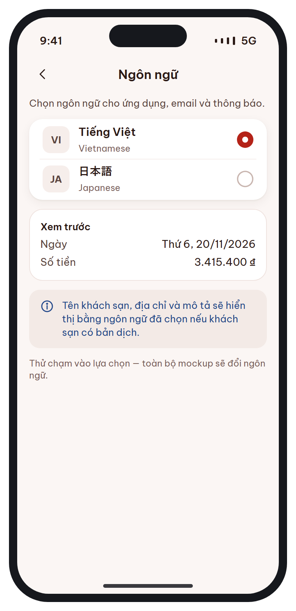
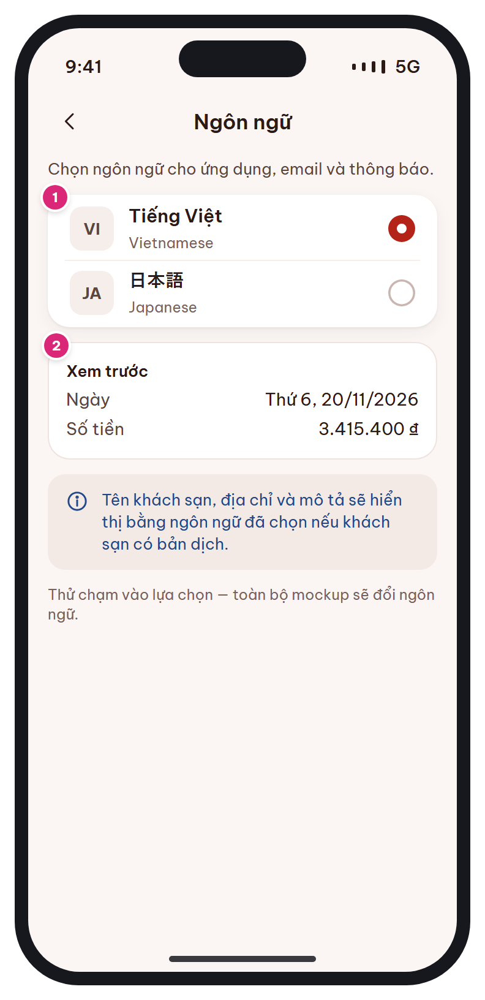

# MB-16b · Cài đặt ngôn ngữ

[‹ MB-16](MB-16.md) · [Danh sách](../README.md) · [— ›](../README.md)

**Luồng:** Thành viên & cài đặt · **Route:** `/account/language` · **Quyền:** Guest / Member

Đổi ngôn ngữ app tức thì; lưu lên server (users.language) để email / push cùng ngôn ngữ.

> Ghi chú thiết kế: Đổi ngay không cần khởi động lại; lưu lên server (users.language) để email/push cùng ngôn ngữ.

| Thiết kế | Có số chú thích |
| :---: | :---: |
|  |  |

## 1. Bố cục

- Header: back + 'Ngôn ngữ'.
- Mô tả.
- Card 2 dòng radio (mã VI / JA, tên bản địa, tên tiếng Anh).
- Card Xem trước (ngày, số tiền theo locale).
- Toast info về bản dịch dữ liệu khách sạn.

## 2. Hạng mục màn hình (画面項目定義)

Cột **No** trùng với số hồng trên ảnh có chú thích.

| No | Hạng mục | Loại UI | Dữ liệu / nguồn | Ràng buộc / validate | Hành động |
| --- | --- | --- | --- | --- | --- |
| 1 | Danh sách ngôn ngữ | List-row radio (badge mã 2 chữ) | users.language: vi \| ja |  | Chạm → đổi locale ngay + PATCH /me (nếu đăng nhập) + cập nhật ngôn ngữ push |
| 2 | Xem trước định dạng | Card kv | Ngày: DateFormat.MMMEd(locale) · Tiền: NumberFormat theo locale | VI: "T6, 20/11" · "3.415.400 ₫" — JA: "11/20(金)" · "3,415,400₫" |  |
| – | Ghi chú bản dịch | Toast brand + icon info | hotels.name_ja, description_ja… | Thiếu bản dịch → hiển thị bản VI |  |

## 3. API

| Method | Endpoint | Ghi chú |
| --- | --- | --- |
| PATCH | `/api/v1/me` | { language } |

## 4. Trạng thái màn hình

| Trạng thái | Hiển thị / xử lý |
| --- | --- |
| PATCH lỗi | Vẫn đổi local, retry ngầm lần mở app sau |

## 5. Quy tắc nghiệp vụ

- Mọi chuỗi qua i18n key, không ghép chuỗi; ngày & tiền định dạng bằng Intl theo locale; chừa 30% độ dài cho chuỗi dài hơn.

## 6. Điều hướng

| Thao tác | Màn đích |
| --- | --- |
| Back | [MB-16](MB-16.md) |

## 7. i18n key gợi ý

`language.title` · `language.desc` · `language.preview` · `language.previewDate` · `language.previewAmount` · `language.dataNote`

## 8. Gợi ý triển khai Flutter

- localeProvider.setLocale(l) → MaterialApp rebuild; intl NumberFormat('#,##0', locale) + ' ₫' / '₫'

---

[‹ MB-16](MB-16.md) · [Danh sách](../README.md) · [— ›](../README.md)
